<p align="center">
  
</p>

<h1 align="center">Tweakly</h1>

<p align="center">
  <b>Was macOS fehlt, in einer nativen App.</b><br>
  Die Auslastung deines Mac in der Menüleiste, Befehl-Tab mit Fenstervorschauen, ein Task-Manager, Live-Hintergrundbilder und mehr.
</p>

<p align="center">
  <a href="../../releases/latest"></a>
  
  
  
  <a href="LICENSE"></a>
</p>

<p align="center">
  <a href="README.md">English</a> · <a href="README.ru.md">Русский</a> · <b>Deutsch</b> · <a href="README.ja.md">日本語</a> · <a href="README.zh-Hans.md">简体中文</a>
</p>

<p align="center">
  <a href="../../releases/latest/download/Tweakly.dmg"><b>Laden</b></a> · <a href="https://tweakly.me">Website</a>
</p>

<picture>
  <source media="(prefers-color-scheme: dark)" srcset=".github/images/home-en-dark.webp">
  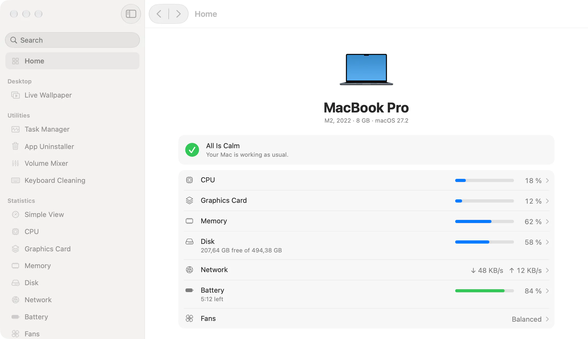
</picture>

## Warum Tweakly

- **Sieht aus wie ein Teil von macOS.** Nur Komponenten, Materialien, Schriften und Farben des Systems: Liquid Glass, wo macOS es hat, Seiten wie in den Systemeinstellungen.
- **Was aus ist, kostet nichts.** Jede Funktion wird einzeln eingeschaltet, und eine ausgeschaltete hat keine Timer, keine Beobachter und keinen Speicher. Der Agent mit allem ausgeschaltet braucht etwa 8 MB und keine CPU.
- **Eine App statt einem Dutzend.** Ohne Abo, ohne Account, ohne Telemetrie.

## Funktionen

### Fenster

**Fensterumschalter.** Befehl-Tab mit einer Kachel und einer Live-Vorschau für jedes Fenster, auch für Fenster im Dock und auf anderen Schreibtischen. Lass die Befehlstaste los, um zu wechseln.

<picture>
  <source media="(prefers-color-scheme: dark)" srcset=".github/images/switcher-en-dark.webp">
  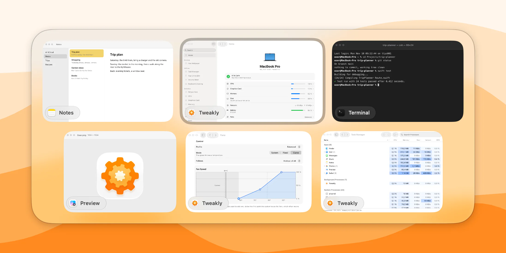
</picture>

**Dock-Vorschauen.** Halte den Zeiger auf einer App im Dock, und ihre Fenster erscheinen darüber. Ein Klick auf die App im Vordergrund legt sie im Dock ab, wie unter Windows.

<picture>
  <source media="(prefers-color-scheme: dark)" srcset=".github/images/dock-en-dark.webp">
  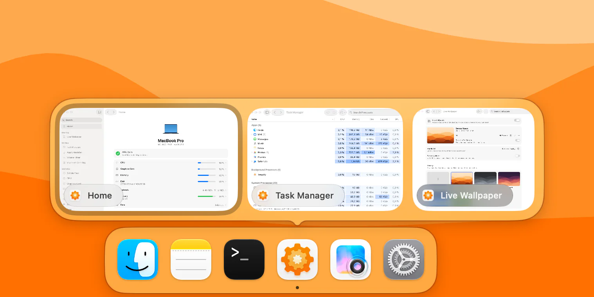
</picture>

### Menüleiste

**Statistik.** CPU, Grafik, Speicher, Festplatte, Netzwerk und Batterie, jeweils mit eigenem Symbol, Stil und Aktualisierungsintervall. Ein Klick öffnet ein Fenster mit einem Diagramm und den Apps, die deinen Mac beschäftigen.

**Einfache Ansicht.** Ein Symbol statt sechs, mit Ringen oder einer Liste. Das Symbol kann ein Zahnrad, eine Katze oder ein eigenes Bild sein und sich mit der Auslastung füllen.

<table>
  <tr>
    <td width="50%">
      <picture>
        <source media="(prefers-color-scheme: dark)" srcset=".github/images/stats-en-dark.webp">
        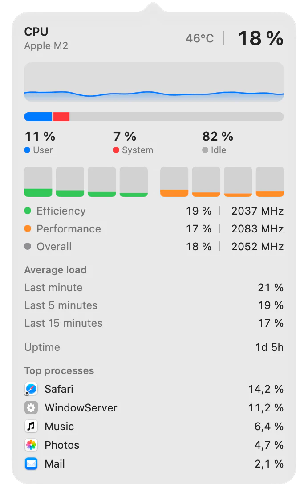
      </picture>
    </td>
    <td width="50%">
      <picture>
        <source media="(prefers-color-scheme: dark)" srcset=".github/images/simple-view-en-dark.webp">
        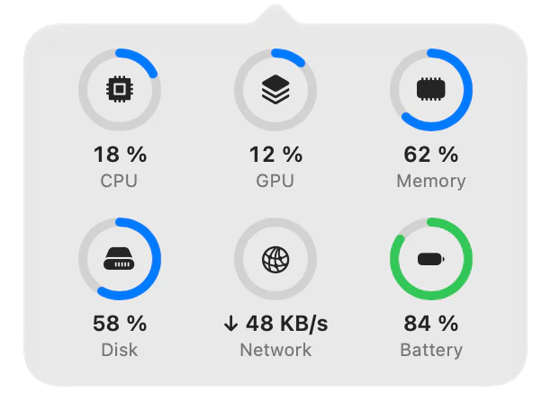
      </picture>
      <br><br>
      <picture>
        <source media="(prefers-color-scheme: dark)" srcset=".github/images/mixer-en-dark.webp">
        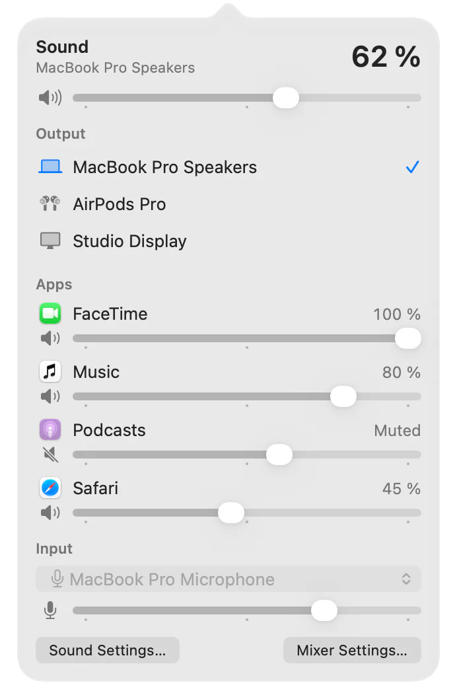
      </picture>
    </td>
  </tr>
</table>

**Lautstärkemixer.** Die Gesamtlautstärke und die Ausgabe, dazu für jede App, die gerade spielt, eine eigene Lautstärke von 0 bis 200 % und eine eigene Ausgabe.

**Lüfter.** Fünf Profile, eine feste Drehzahl oder eine eigene Kurve nach dem Sensor deiner Wahl, je Lüfter und für den Batteriebetrieb. Auf Macs mit Lüftern.

### Dienstprogramme

**Task-Manager.** Alle Prozesse in einer Tabelle mit CPU, Speicher, Festplatte, Netzwerk und GPU, getrennt nach Apps, Hintergrund- und Systemprozessen. Öffnet sich mit Control-Umschalt-Escape.

<picture>
  <source media="(prefers-color-scheme: dark)" srcset=".github/images/task-manager-en-dark.webp">
  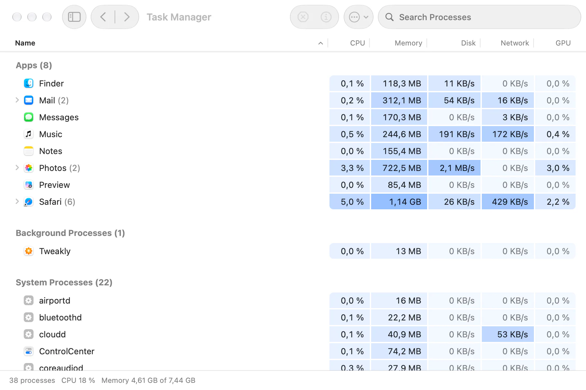
</picture>

**App-Deinstallation.** Entfernt eine App mit ihren Einstellungen, Caches, Daten, Containern und Hintergrunddiensten. Alles landet im Papierkorb und lässt sich zurücklegen.

<picture>
  <source media="(prefers-color-scheme: dark)" srcset=".github/images/uninstaller-en-dark.webp">
  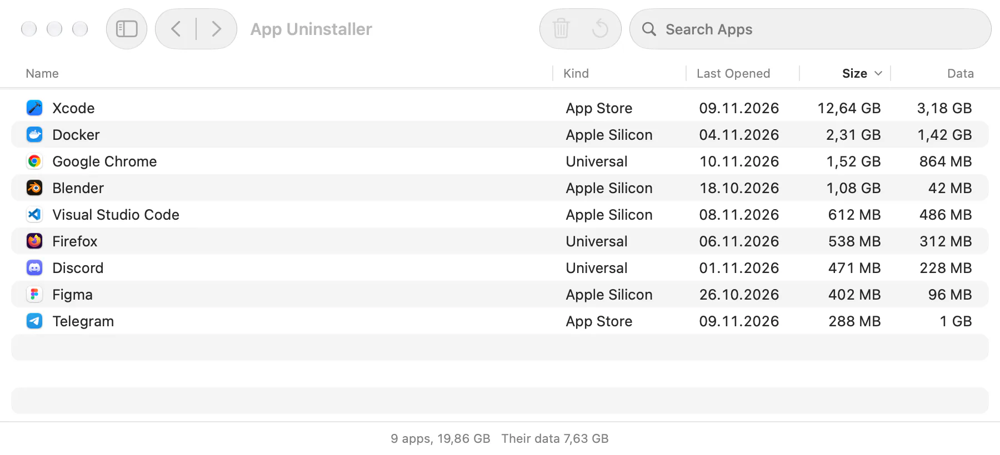
</picture>

**Tastaturreinigung.** Schaltet die Tastatur eine Weile aus, damit du sie abwischen kannst. Trackpad und Maus funktionieren weiter.

### Schreibtisch

**Live-Hintergrundbild.** Videos und Bilder auf dem Schreibtisch, eine eigene Mediathek und ein Browser für Hintergrundbild-Websites. Ein Video läuft nur, solange es jemand sieht, und pausiert auf Wunsch im Batteriebetrieb.

<picture>
  <source media="(prefers-color-scheme: dark)" srcset=".github/images/live-wallpaper-en-dark.webp">
  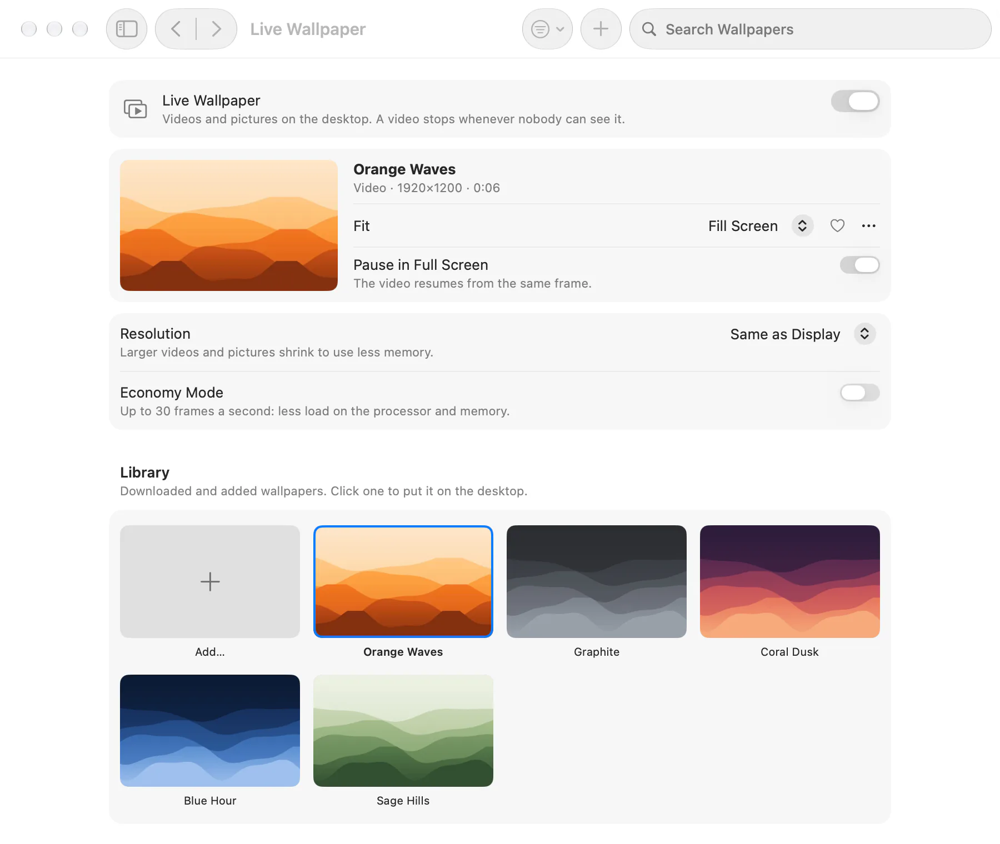
</picture>

### Eingabe und Finder

**Maus.** Ein Zeiger ohne Beschleunigung mit eigener Geschwindigkeit, ein Rad unabhängig vom Trackpad, weiches Scrollen sowie Zurück und Vorwärts auf den Seitentasten.

**Sprachwechsel.** Ein kurzer Druck auf Fn wechselt zur vorherigen Eingabequelle, ohne Menü.

**Ausschneiden im Finder.** Befehl-X schneidet Dateien aus, Befehl-V bewegt sie. Der Finder bewegt sie selbst.

**Finder-Menü.** „Neue Datei“, „Pfad kopieren“ und „In Terminal öffnen“ per Rechtsklick.

<table>
  <tr>
    <td width="50%">
      <picture>
        <source media="(prefers-color-scheme: dark)" srcset=".github/images/mouse-en-dark.webp">
        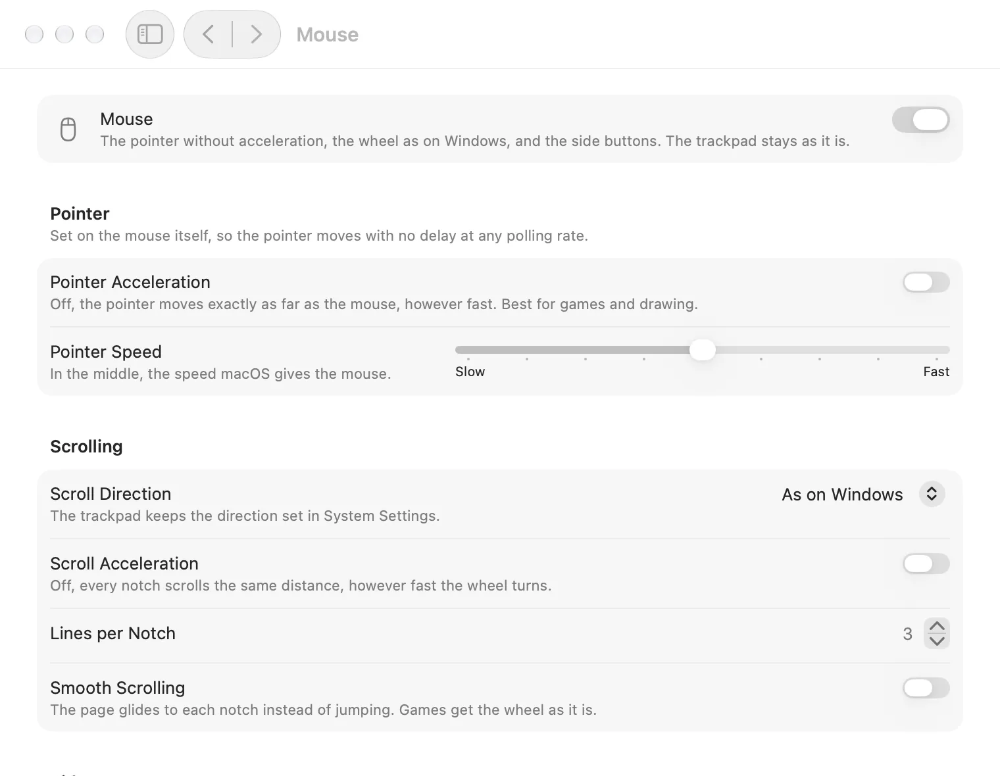
      </picture>
    </td>
    <td width="50%">
      <picture>
        <source media="(prefers-color-scheme: dark)" srcset=".github/images/fans-en-dark.webp">
        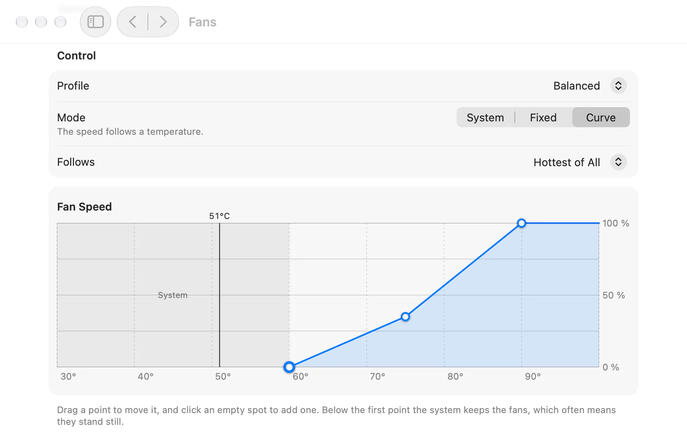
      </picture>
    </td>
  </tr>
</table>

## Installation

1. Lade [Tweakly.dmg](../../releases/latest/download/Tweakly.dmg), das neueste Release.
2. Öffne das Image und zieh Tweakly in den Ordner „Programme“.
3. Öffne Tweakly. macOS fragt einmal, ob du eine aus dem Internet geladene App öffnen möchtest.

Tweakly ist mit Developer ID signiert und von Apple notarisiert. Es braucht **macOS 26 oder neuer auf einem Mac mit Apple silicon**.

Updates behalten Einstellungen und Berechtigungen: Installiere die neue Version einfach über die alte.

## Berechtigungen

Tweakly fragt nach einer Berechtigung nur, wenn du eine Funktion einschaltest, die sie braucht, und nie beim Start. Alle stehen auf einer Seite, **Berechtigungen**, wie unter „Datenschutz & Sicherheit“: wofür jede ist, welche Funktionen sie nutzen, ob sie erteilt ist, und eine Taste, die sie erteilt. Nimmst du eine zurück, schalten sich die Funktionen, die sie brauchen, selbst aus und sagen, warum.

| Berechtigung | Wofür |
|---|---|
| Bedienungshilfen | Fensterumschalter, Dock-Vorschauen, Maus (Rad und Tasten), Ausschneiden im Finder, Sprachwechsel, Tastaturreinigung |
| Aufnahme von Bildschirm & Systemaudio | Fenstervorschauen im Fensterumschalter und in den Dock-Vorschauen. Ohne sie zeigen die Kacheln App-Symbole |
| Nur Aufnahme von Systemaudio | Eine eigene Lautstärke für jede App im Lautstärkemixer |
| Festplattenvollzugriff | App-Deinstallation, für die Daten von Apps aus dem App Store. Optional |
| Dateien & Ordner | „Neue Datei“ im Finder-Menü auf dem Schreibtisch und in „Dokumente“ und „Downloads“ |
| Administratorpasswort, einmal | Das Hilfsprogramm für die Lüfter und für Prozesse anderer Benutzer im Task-Manager |

## Datenschutz

Tweakly hat keine Analyse, keine Accounts und keinen Update-Server. Online geht es nur in zwei Fällen:

- Solange das Netzwerkfenster offen ist, fragt es Cloudflare (`1.1.1.1`) nach deiner öffentlichen Adresse und misst die Verzögerung dorthin.
- Der Hintergrundbild-Browser öffnet die Websites, die du darin besuchst.

Bilder und Videos von außen prüft ein Hilfsprogramm in einer Sandbox ohne Netzwerkzugang und schreibt sie neu, bevor irgendetwas anderes sie liest.

## Häufige Fragen

**Die Symbole von Tweakly fehlen in der Menüleiste.**
Auf einem Mac mit Notch landet, was nicht passt, hinter der Notch, und macOS kann die Symbole einer App ausblenden: Prüfe, ob Tweakly unter „Systemeinstellungen“ › „Menüleiste“ erlaubt ist. Bei einer vollen Menüleiste helfen weniger Symbole oder die Einfache Ansicht, die nur ein Symbol braucht.

**In den Systemeinstellungen ist eine Berechtigung an, aber Tweakly sagt, sie fehlt.**
macOS bindet Berechtigungen an die Signatur einer App, ein Schalter aus einem anderen Build gilt also nicht mehr. Schalte Tweakly in den Systemeinstellungen aus und wieder ein, oder setze die Berechtigung im Terminal zurück und erteile sie auf der Seite „Berechtigungen“ neu:

```bash
tccutil reset Accessibility me.tweakly.Tweakly
```

**Die Fenstervorschauen zeigen App-Symbole statt Bildern.**
Vorschauen brauchen „Aufnahme von Bildschirm & Systemaudio“. Erteile sie auf der Seite „Berechtigungen“; die Bilder erscheinen nach einem Neustart von Tweakly, den die App anbietet. macOS zeigt bei jedem Bild für ein paar Sekunden die Aufnahmeanzeige.

**Es gibt keine Seite „Lüfter“.**
Sie erscheint nur auf Macs mit Lüftern. Das MacBook Air hat keine.

**Warum nur macOS 26 und Apple silicon?**
Tweakly besteht aus den Komponenten von macOS 26, darunter Liquid Glass, und liest die Sensoren und den Aufbau der Kerne von Apple silicon.

## Deinstallieren

1. Wenn du Live-Hintergrundbilder nutzt, schalte sie zuerst aus: Tweakly stellt dein Schreibtischbild wieder her.
2. Wenn du das Hilfsprogramm für Lüfter oder den Task-Manager installiert hast, entferne es: „Lüfter“ › „Weitere Optionen …“ › „Entfernen …“.
3. Beende Tweakly („Info“ › „Tweakly beenden“) und bewege es aus „Programme“ in den Papierkorb.

Um auch Einstellungen und Daten zu entfernen:

```bash
defaults delete me.tweakly.Tweakly
rm -rf ~/Library/Application\ Support/me.tweakly.Tweakly ~/Library/Caches/me.tweakly.Tweakly
tccutil reset All me.tweakly.Tweakly
```

Auf einem Mac ohne Lüfter, der keine Seite „Lüfter“ hat, entfernst du das Hilfsprogramm so:

```bash
sudo launchctl bootout system/me.tweakly.Tweakly.fanhelper
sudo rm /Library/LaunchDaemons/me.tweakly.Tweakly.fanhelper.plist /Library/PrivilegedHelperTools/me.tweakly.Tweakly.fanhelper
```

## Sprachen

Englisch, Russisch, Deutsch, Japanisch und vereinfachtes Chinesisch. Das Fenster, die Menüleiste und die Fenster der Menüleiste können jeweils eine eigene Sprache haben.

## Aus dem Quellcode erstellen

Du brauchst Xcode 27 mit dem macOS 26 SDK.

```bash
xcodebuild -project Tweakly.xcodeproj -scheme Tweakly -configuration Release -derivedDataPath build build
```

Die Logik jeder Funktion liegt in einem eigenen Swift-Paket unter `Packages/`, mit eigenen Tests:

```bash
swift test --package-path Packages/SystemMetrics
```

Ein selbst signierter Build bekommt eigene Berechtigungen: macOS bindet sie an die Signatur, ein Build mit einer anderen muss sie neu erhalten.

## Mitmachen

Fehlerberichte, Ideen und Übersetzungen sind willkommen. Lies bitte zuerst [CONTRIBUTING.md](CONTRIBUTING.md) und melde Sicherheitslücken vertraulich, wie in [SECURITY.md](SECURITY.md) beschrieben.

## Lizenz

[MIT](LICENSE)
