<p align="center">
  
</p>

<h1 align="center">Tweakly</h1>

<p align="center">
  <b>macOSに足りないものを、ひとつのネイティブアプリに。</b><br>
  メニューバーのMacの負荷、ウインドウプレビュー付きのCommand＋Tab、タスクマネージャ、ライブ壁紙など。
</p>

<p align="center">
  <a href="../../releases/latest"></a>
  
  
  
  <a href="LICENSE"></a>
</p>

<p align="center">
  <a href="README.md">English</a> · <a href="README.ru.md">Русский</a> · <a href="README.de.md">Deutsch</a> · <b>日本語</b> · <a href="README.zh-Hans.md">简体中文</a>
</p>

<p align="center">
  <a href="../../releases/latest/download/Tweakly.dmg"><b>ダウンロード</b></a> · <a href="https://tweakly.me">Webサイト</a>
</p>

<picture>
  <source media="(prefers-color-scheme: dark)" srcset=".github/images/home-en-dark.webp">
  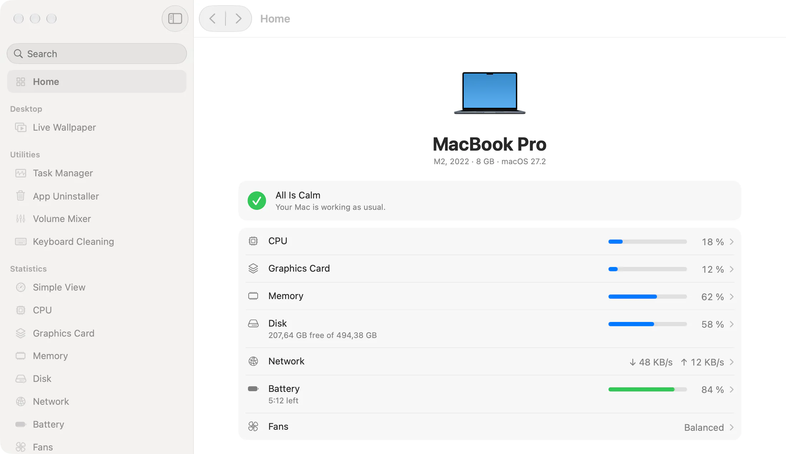
</picture>

## Tweaklyの特長

- **macOSの一部のような見た目。** システムのコンポーネント、素材、フォント、色だけを使っています。macOSにあるところではLiquid Glassを使い、ページは“システム設定”と同じ作りです。
- **オフの機能はコストゼロ。** 機能はひとつずつオンにでき、オフの機能はタイマーもオブザーバもメモリも使いません。すべてオフのエージェントは約8 MBで、CPUを使いません。
- **アプリ1つで十分。** サブスクリプションもアカウントもテレメトリもありません。

## 機能

### ウインドウ

**ウインドウスイッチャー。** すべてのウインドウのタイルとライブプレビューを表示するCommand＋Tab。しまったウインドウやほかのデスクトップのウインドウも表示されます。Commandキーを離すと切り替わります。

<picture>
  <source media="(prefers-color-scheme: dark)" srcset=".github/images/switcher-en-dark.webp">
  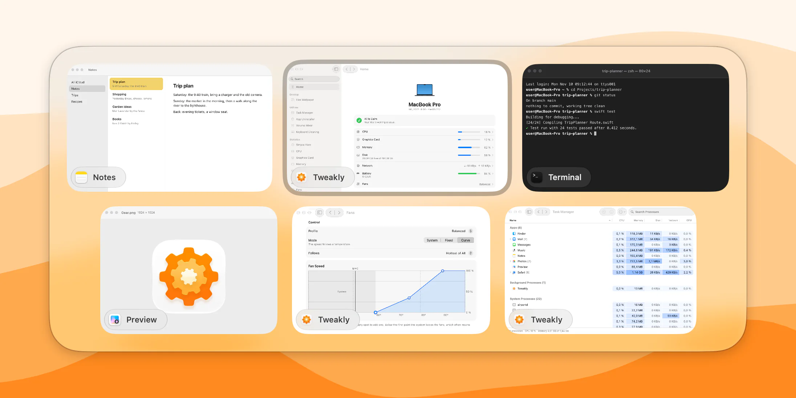
</picture>

**Dockプレビュー。** Dockのアプリにポインタを置くと、そのアプリのウインドウが上に表示されます。前面のアプリをクリックすると、Windowsのようにしまえます。

<picture>
  <source media="(prefers-color-scheme: dark)" srcset=".github/images/dock-en-dark.webp">
  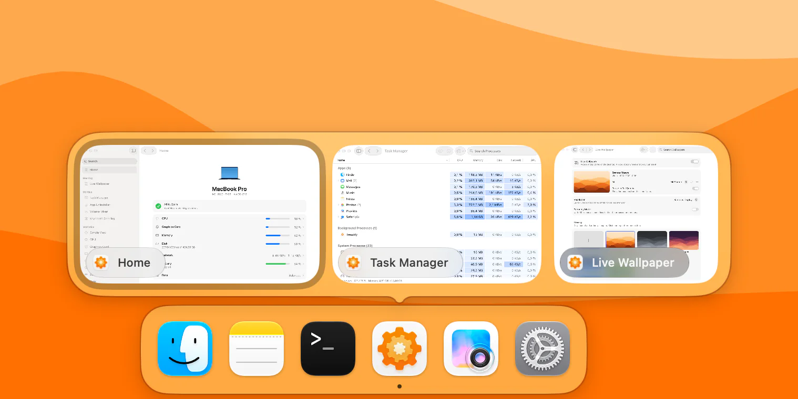
</picture>

### メニューバー

**統計。** CPU、グラフィックス、メモリ、ディスク、ネットワーク、バッテリー。それぞれにアイコン、スタイル、更新間隔を設定できます。クリックすると、グラフとMacに負荷をかけているアプリのパネルが開きます。

**シンプル表示。** 6つのアイコンを1つにまとめ、リングまたはリストのパネルで表示します。アイコンは歯車、猫、または自分の画像にでき、負荷に合わせて塗りつぶすこともできます。

<table>
  <tr>
    <td width="50%">
      <picture>
        <source media="(prefers-color-scheme: dark)" srcset=".github/images/stats-en-dark.webp">
        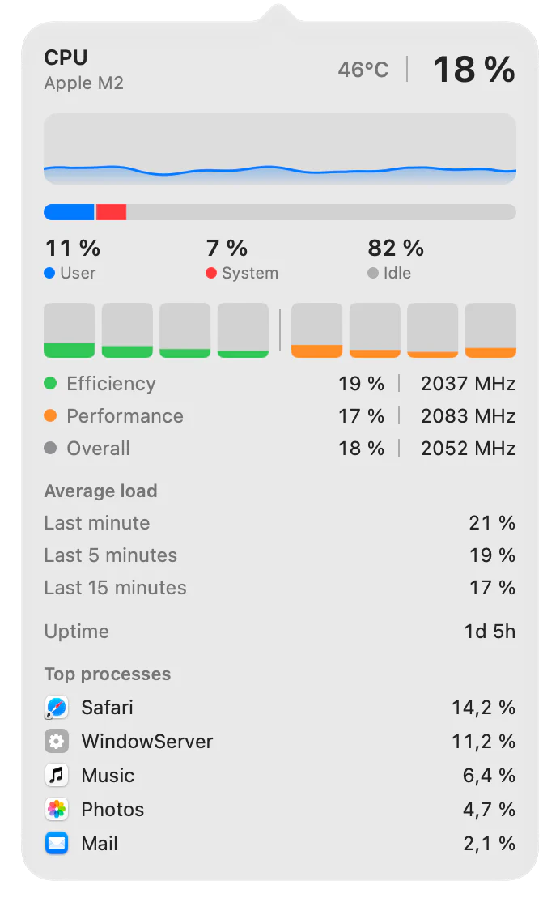
      </picture>
    </td>
    <td width="50%">
      <picture>
        <source media="(prefers-color-scheme: dark)" srcset=".github/images/simple-view-en-dark.webp">
        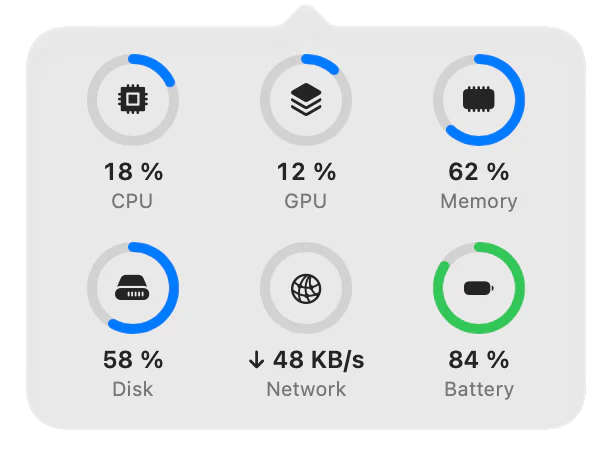
      </picture>
      <br><br>
      <picture>
        <source media="(prefers-color-scheme: dark)" srcset=".github/images/mixer-en-dark.webp">
        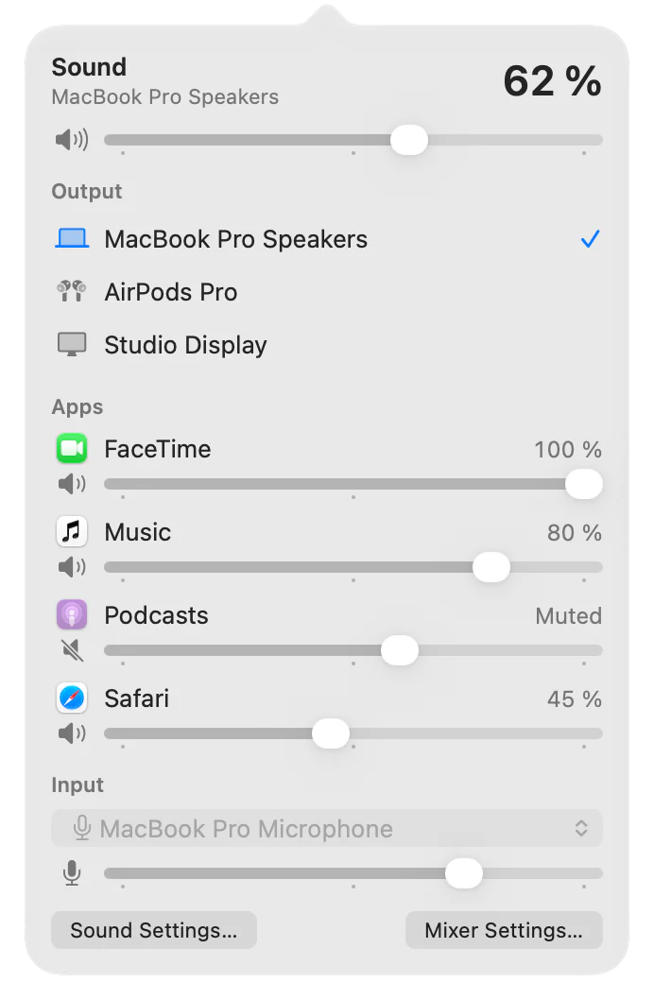
      </picture>
    </td>
  </tr>
</table>

**音量ミキサー。** 全体の音量と出力に加えて、再生中のアプリごとに0〜200%の音量と出力を設定できます。

**ファン。** 5つのプロファイル、一定の回転数、または選んだセンサーに従う独自のカーブ。ファンごと、バッテリー使用時にも設定できます。ファンのあるMacで使えます。

### ユーティリティ

**タスクマネージャ。** すべてのプロセスをCPU、メモリ、ディスク、ネットワーク、GPUとともに1つの表に表示し、アプリ、バックグラウンドプロセス、システムプロセスに分けます。Control＋Shift＋Escapeで開きます。

<picture>
  <source media="(prefers-color-scheme: dark)" srcset=".github/images/task-manager-en-dark.webp">
  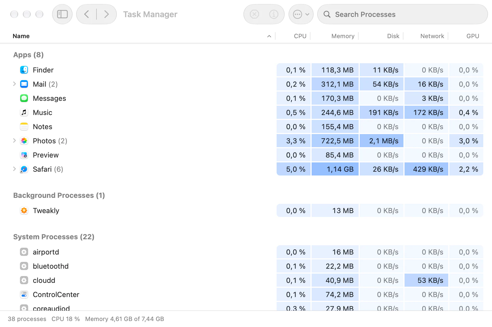
</picture>

**アンインストーラ。** アプリとその設定、キャッシュ、データ、コンテナ、バックグラウンドサービスをまとめて削除します。すべてゴミ箱に入るので、いつでも戻せます。

<picture>
  <source media="(prefers-color-scheme: dark)" srcset=".github/images/uninstaller-en-dark.webp">
  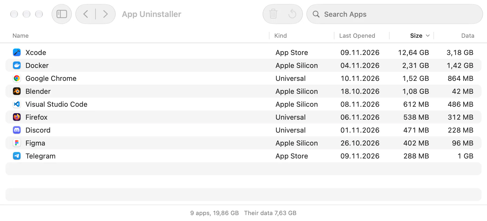
</picture>

**キーボードクリーニング。** 拭いている間、キーボードをしばらくオフにします。トラックパッドとマウスはそのまま使えます。

### デスクトップ

**ライブ壁紙。** デスクトップに動画や画像を表示します。自分のライブラリと壁紙サイトのブラウザ付き。動画は誰かに見えているときだけ再生し、必要ならバッテリー使用時に一時停止します。

<picture>
  <source media="(prefers-color-scheme: dark)" srcset=".github/images/live-wallpaper-en-dark.webp">
  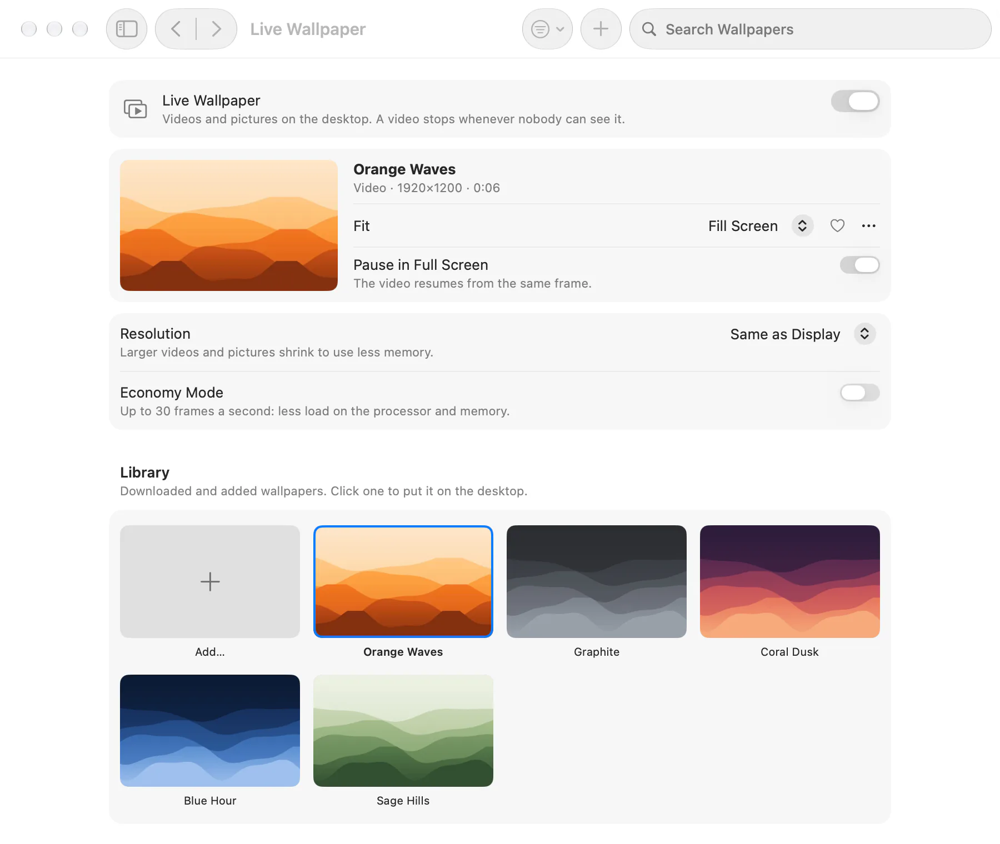
</picture>

### 入力とFinder

**マウス。** 加速なしのポインタと自分で決めた速度、トラックパッドとは別のホイール、スムーズスクロール、サイドボタンでの戻る・進む。

**言語切り替え。** Fnを短く押すと、メニューを出さずに前の入力ソースに切り替わります。

**Finderでカット。** Command＋Xでファイルをカットし、Command＋Vで移動します。移動はFinder自身が行います。

**Finderメニュー。** 右クリックのメニューに、新規ファイル、パスをコピー、“ターミナル”で開くを追加します。

<table>
  <tr>
    <td width="50%">
      <picture>
        <source media="(prefers-color-scheme: dark)" srcset=".github/images/mouse-en-dark.webp">
        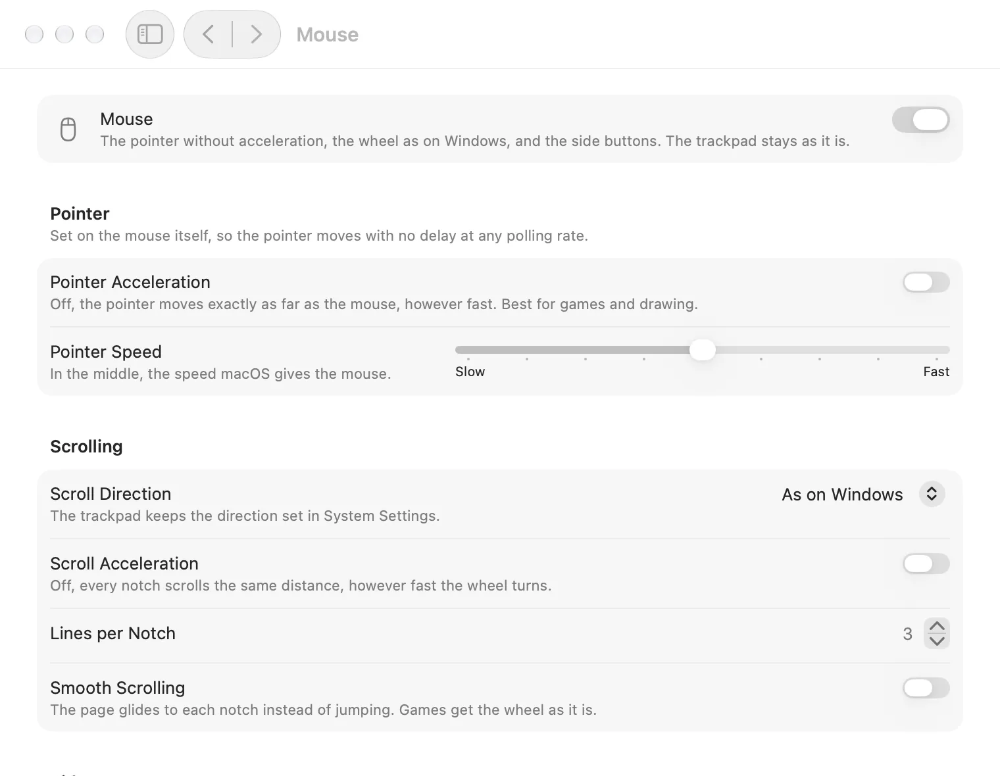
      </picture>
    </td>
    <td width="50%">
      <picture>
        <source media="(prefers-color-scheme: dark)" srcset=".github/images/fans-en-dark.webp">
        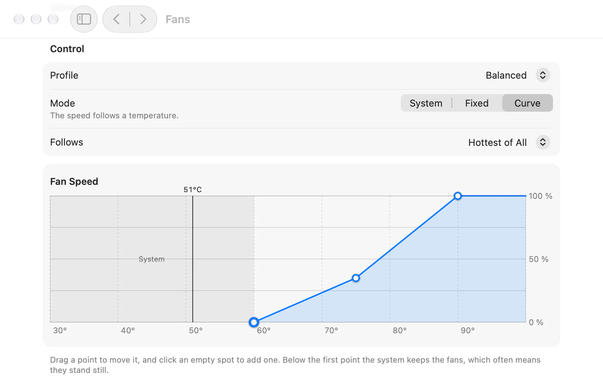
      </picture>
    </td>
  </tr>
</table>

## インストール

1. 最新リリースの[Tweakly.dmg](../../releases/latest/download/Tweakly.dmg)をダウンロードします。
2. ディスクイメージを開き、Tweaklyを“アプリケーション”にドラッグします。
3. Tweaklyを開きます。インターネットからダウンロードしたアプリを開くかどうか、macOSが一度だけ確認します。

TweaklyはDeveloper IDで署名され、Appleによって公証されています。**Appleシリコン搭載Macで、macOS 26以降**が必要です。

アップデートしても設定とアクセス権はそのままです。新しいバージョンを古いバージョンの上にインストールしてください。

## アクセス権

Tweaklyがアクセス権を求めるのは、それが必要な機能をオンにしたときだけで、起動時には求めません。すべてのアクセス権は“プライバシーとセキュリティ”と同じように**アクセス権**のページにまとまっています。それぞれの用途、使う機能、許可されているかどうか、そして許可するためのボタン。許可を取り消すと、それを必要とする機能は自動でオフになり、理由を表示します。

| アクセス権 | 用途 |
|---|---|
| アクセシビリティ | ウインドウスイッチャー、Dockプレビュー、マウス（ホイールとボタン）、Finderでカット、言語切り替え、キーボードクリーニング |
| 画面収録とシステムオーディオ録音 | ウインドウスイッチャーとDockプレビューのウインドウプレビュー。許可がない場合、タイルにはアプリのアイコンが表示されます |
| システムオーディオ録音のみ | 音量ミキサーのアプリごとの音量 |
| フルディスクアクセス | アンインストーラで、App Storeのアプリのデータを見つけるため。任意です |
| ファイルとフォルダ | Finderメニューの“新規ファイル”を、デスクトップ、“書類”、“ダウンロード”で使うため |
| 管理者パスワード（一度だけ） | ファンと、タスクマネージャでほかのユーザのプロセスを扱うためのヘルパー |

## プライバシー

Tweaklyには分析も、アカウントも、アップデートサーバもありません。インターネットに接続するのは次の2つの場合だけです：

- ネットワークのパネルが開いている間、Cloudflare（`1.1.1.1`）にグローバルIPアドレスを問い合わせ、そこまでの遅延を計測します。
- 壁紙ブラウザは、その中で開いたサイトを表示します。

外部の画像や動画は、ほかの部分が読み込む前に、ネットワークにアクセスできないサンドボックス内のヘルパーが確認して書き直します。

## よくある質問

**メニューバーにTweaklyのアイコンが表示されません。**
カメラハウジングのあるMacでは、入りきらない項目はその裏に隠れます。また、macOSはアプリの項目を非表示にできます。“システム設定”›“メニューバー”でTweaklyが許可されているか確認してください。メニューバーがいっぱいの場合は、項目を減らすか、アイコンが1つで済むシンプル表示を使ってください。

**“システム設定”では許可されているのに、Tweaklyは許可されていないと表示します。**
macOSはアクセス権をアプリの署名に結び付けるため、別のビルドで許可したスイッチは無効になります。“システム設定”でTweaklyのスイッチをオフにしてからオンにするか、ターミナルでリセットして“アクセス権”のページで改めて許可してください：

```bash
tccutil reset Accessibility me.tweakly.Tweakly
```

**ウインドウプレビューに画像ではなくアプリのアイコンが表示されます。**
プレビューには“画面収録とシステムオーディオ録音”が必要です。“アクセス権”のページで許可すると、Tweaklyの再起動後に画像が表示されます（再起動はアプリが案内します）。画像を撮るたびに、macOSは数秒間録画インジケータを表示します。

**“ファン”のページがありません。**
ファンのあるMacにだけ表示されます。MacBook Airにはファンがありません。

**macOS 26とAppleシリコンだけに対応しているのはなぜですか？**
TweaklyはLiquid Glassを含むmacOS 26自身のコンポーネントで作られており、Appleシリコンのセンサーとコア構成を読み取るためです。

## アンインストール

1. ライブ壁紙を使っている場合は、先にオフにしてください。Tweaklyがデスクトップピクチャを元に戻します。
2. ファンやタスクマネージャ用のヘルパーをインストールした場合は、“ファン”›“詳細…”›“削除…”で削除してください。
3. Tweaklyを終了し（“情報”›“Tweaklyを終了”）、“アプリケーション”からゴミ箱に入れます。

設定とデータも削除する場合：

```bash
defaults delete me.tweakly.Tweakly
rm -rf ~/Library/Application\ Support/me.tweakly.Tweakly ~/Library/Caches/me.tweakly.Tweakly
tccutil reset All me.tweakly.Tweakly
```

ファンのないMac（“ファン”のページがないMac）では、ヘルパーを次のコマンドで削除します：

```bash
sudo launchctl bootout system/me.tweakly.Tweakly.fanhelper
sudo rm /Library/LaunchDaemons/me.tweakly.Tweakly.fanhelper.plist /Library/PrivilegedHelperTools/me.tweakly.Tweakly.fanhelper
```

## 言語

英語、ロシア語、ドイツ語、日本語、簡体字中国語。ウインドウ、メニューバー、パネルごとに言語を選べます。

## ソースからビルド

macOS 26 SDKを含むXcode 27が必要です。

```bash
xcodebuild -project Tweakly.xcodeproj -scheme Tweakly -configuration Release -derivedDataPath build build
```

各機能のロジックは`Packages/`内の個別のSwiftパッケージにあり、それぞれにテストがあります：

```bash
swift test --package-path Packages/SystemMetrics
```

自分で署名したビルドには、別のアクセス権が必要です。macOSはアクセス権を署名に結び付けるため、署名が異なるビルドは改めて許可する必要があります。

## コントリビュート

バグ報告、アイデア、翻訳を歓迎します。まず[CONTRIBUTING.md](CONTRIBUTING.md)をお読みください。脆弱性は[SECURITY.md](SECURITY.md)に書かれているとおり、非公開で報告してください。

## ライセンス

[MIT](LICENSE)
