<p align="center">
  
</p>

<h1 align="center">Tweakly</h1>

<p align="center">
  <b>The small things macOS left out, in one native app.</b><br>
  Your Mac's load in the menu bar, Command-Tab with window previews, a task manager, live wallpaper and more.
</p>

<p align="center">
  <a href="../../releases/latest"></a>
  
  
  
  <a href="LICENSE"></a>
</p>

<p align="center">
  <b>English</b> · <a href="README.ru.md">Русский</a> · <a href="README.de.md">Deutsch</a> · <a href="README.ja.md">日本語</a> · <a href="README.zh-Hans.md">简体中文</a>
</p>

<p align="center">
  <a href="../../releases/latest"><b>Download</b></a> · <a href="https://tweakly.me">Website</a>
</p>

<picture>
  <source media="(prefers-color-scheme: dark)" srcset=".github/images/home-en-dark.webp">
  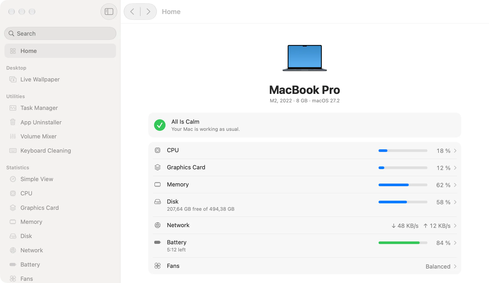
</picture>

## Why Tweakly

- **Looks like part of macOS.** Only system components, materials, fonts and colors: Liquid Glass where macOS has it, System Settings pages in the window.
- **Costs nothing when off.** Every feature turns on by itself, and one that is off has no timers, no observers and no memory. The agent with everything off takes about 8 MB and no CPU.
- **One app instead of a dozen.** No subscriptions, no accounts, no telemetry.

## Features

### Windows

**Window Switcher.** Command-Tab with a tile and a live preview for every window, minimized ones and those on other desktops too. Release Command to switch.

<picture>
  <source media="(prefers-color-scheme: dark)" srcset=".github/images/switcher-en-dark.webp">
  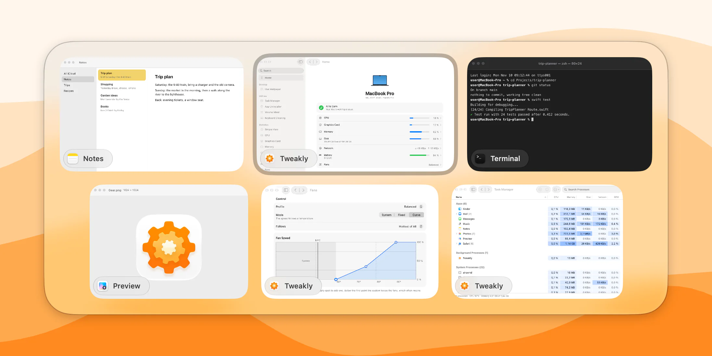
</picture>

**Dock Previews.** Rest the pointer on an app in the Dock and its windows appear above it. A click on the app in front minimizes it, as on Windows.

<picture>
  <source media="(prefers-color-scheme: dark)" srcset=".github/images/dock-en-dark.webp">
  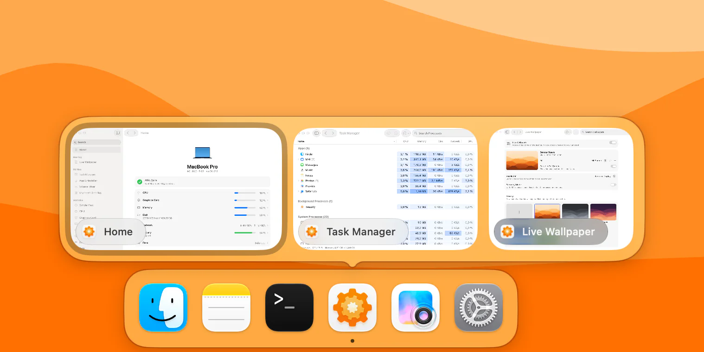
</picture>

### Menu bar

**Stats.** CPU, graphics, memory, disk, network and battery, each with its own icon, style and update rate. A click opens a panel with a graph and the apps keeping your Mac busy.

**Simple View.** One icon instead of six, with a panel of rings or a list. The icon can be a gear, a cat or a picture of your own, and it can fill up with the load.

<table>
  <tr>
    <td width="50%">
      <picture>
        <source media="(prefers-color-scheme: dark)" srcset=".github/images/stats-en-dark.webp">
        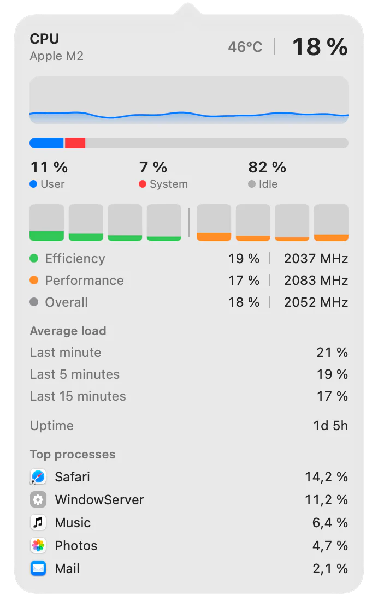
      </picture>
    </td>
    <td width="50%">
      <picture>
        <source media="(prefers-color-scheme: dark)" srcset=".github/images/simple-view-en-dark.webp">
        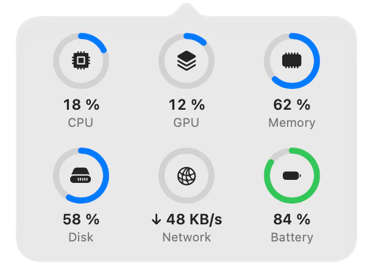
      </picture>
      <br><br>
      <picture>
        <source media="(prefers-color-scheme: dark)" srcset=".github/images/mixer-en-dark.webp">
        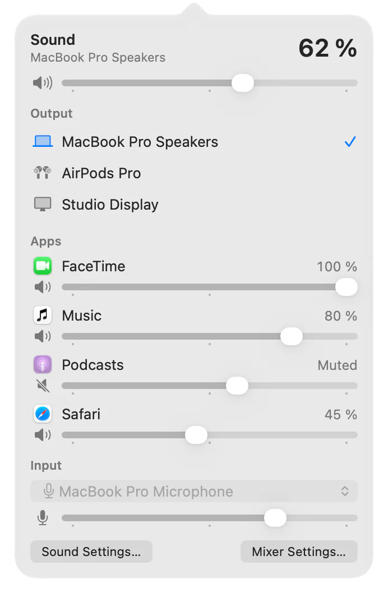
      </picture>
    </td>
  </tr>
</table>

**Volume Mixer.** The overall volume and output, and for each app that plays, a volume from 0 to 200 % and an output of its own.

**Fans.** Five profiles, a fixed speed or your own curve that follows the sensor you choose, per fan and on battery. On Macs with fans.

### Utilities

**Task Manager.** Every process in one table with CPU, memory, disk, network and GPU, split into apps, background and system processes. Opens with Control-Shift-Escape.

<picture>
  <source media="(prefers-color-scheme: dark)" srcset=".github/images/task-manager-en-dark.webp">
  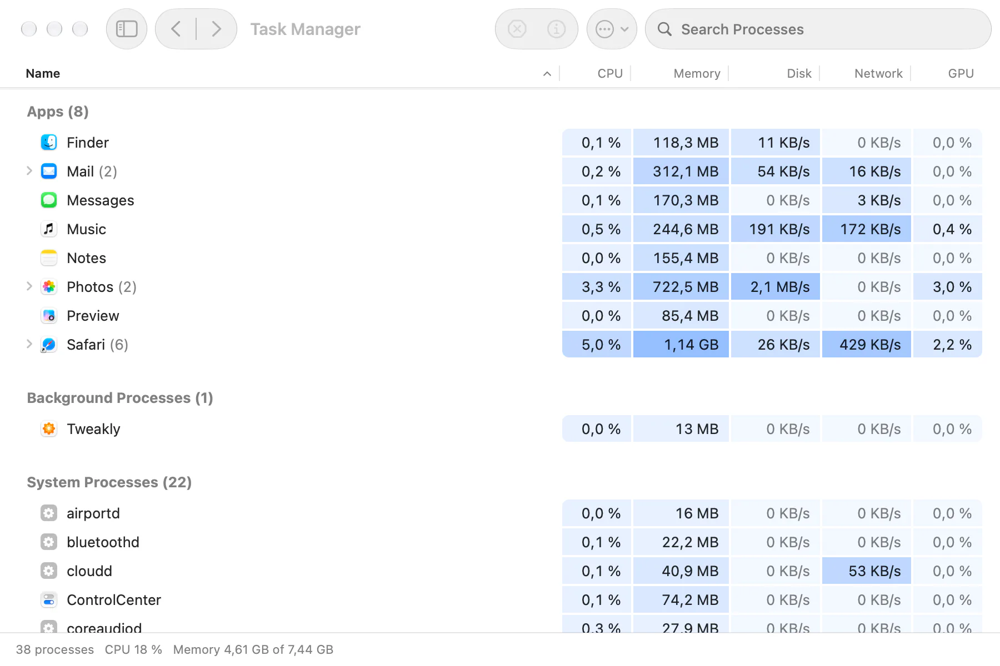
</picture>

**App Uninstaller.** Removes an app with its settings, caches, data, containers and background services, all to the Trash, so anything can be put back.

<picture>
  <source media="(prefers-color-scheme: dark)" srcset=".github/images/uninstaller-en-dark.webp">
  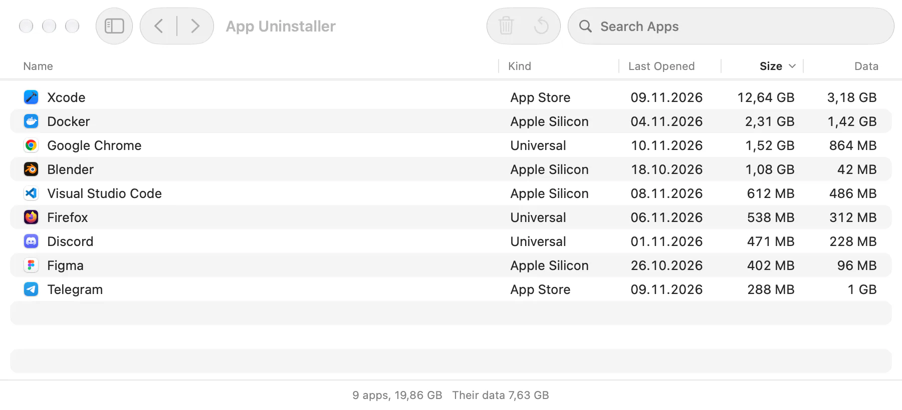
</picture>

**Keyboard Cleaning.** Turns the keyboard off for a while so you can wipe it. The trackpad and mouse keep working.

### Desktop

**Live Wallpaper.** Videos and pictures on the desktop, your own library and a browser of wallpaper sites. A video plays only while someone can see it, and pauses on battery if you like.

<picture>
  <source media="(prefers-color-scheme: dark)" srcset=".github/images/live-wallpaper-en-dark.webp">
  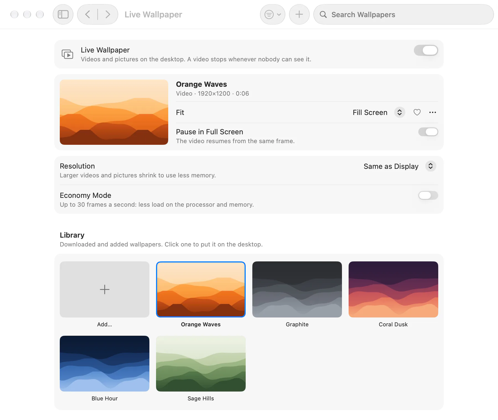
</picture>

### Input and Finder

**Mouse.** A pointer without acceleration at a speed of your own, a wheel that scrolls apart from the trackpad, smooth scrolling, and Back and Forward on the side buttons.

**Language Switch.** A short press of Fn switches to the previous input source, without the menu.

**Cut in Finder.** Cut files with Command-X and move them with Command-V. Finder moves them itself.

**Finder Menu.** New File, Copy Path and Open in Terminal on the right click.

<table>
  <tr>
    <td width="50%">
      <picture>
        <source media="(prefers-color-scheme: dark)" srcset=".github/images/mouse-en-dark.webp">
        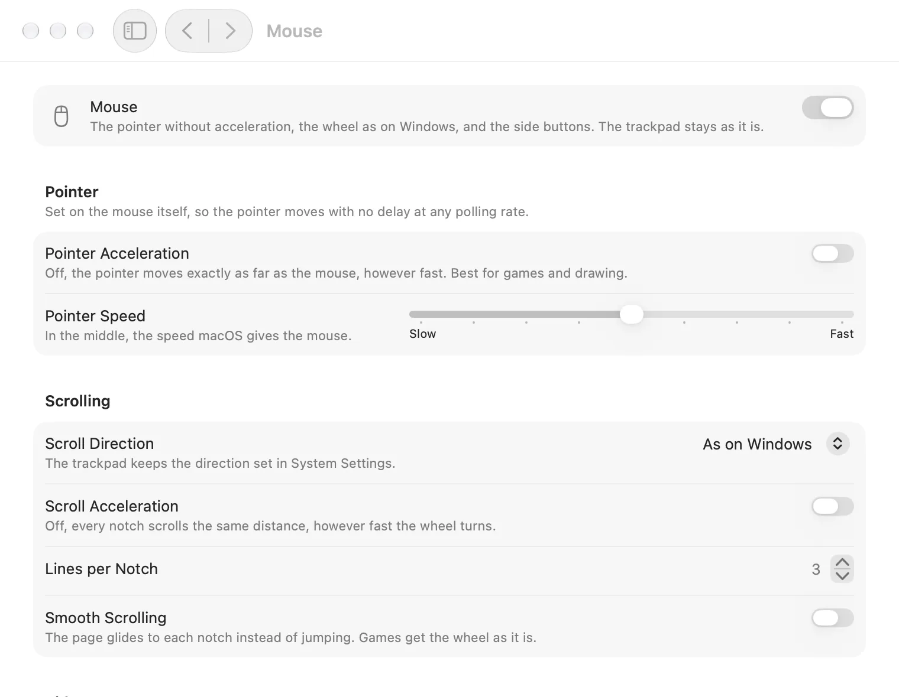
      </picture>
    </td>
    <td width="50%">
      <picture>
        <source media="(prefers-color-scheme: dark)" srcset=".github/images/fans-en-dark.webp">
        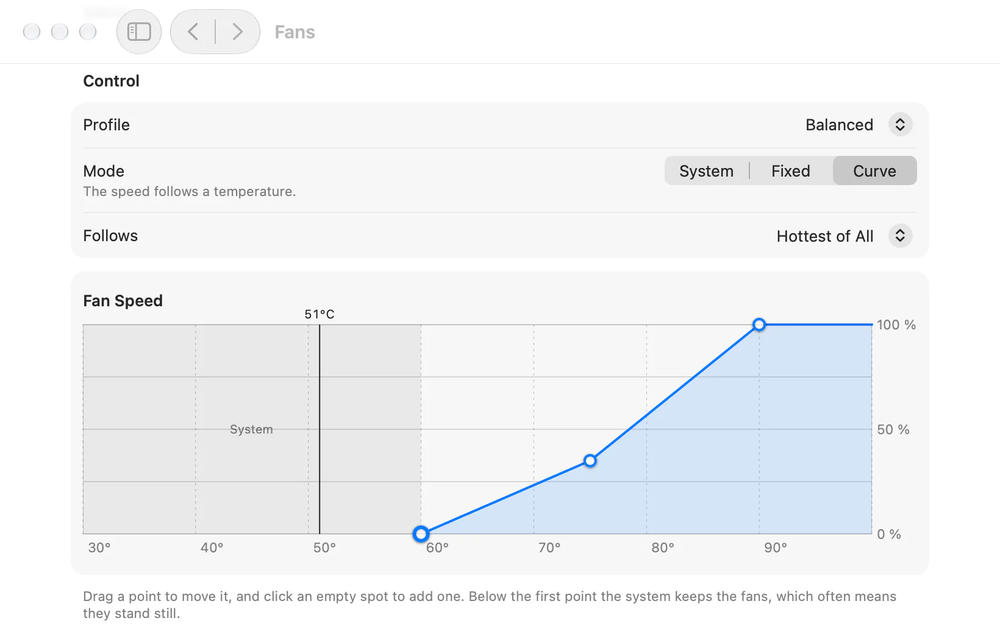
      </picture>
    </td>
  </tr>
</table>

## Install

1. Download `Tweakly-1.0.0.dmg` from [Releases](../../releases/latest).
2. Open it and drag Tweakly to Applications.
3. Open Tweakly. macOS asks once whether to open an app downloaded from the internet.

Tweakly is signed with Developer ID and notarized by Apple. It needs **macOS 26 or later on a Mac with Apple silicon**.

Updates keep your settings and permissions: install the new version over the old one.

## Permissions

Tweakly asks for a permission only when you turn on a feature that needs it, never at launch. All of them are on one page, **Permissions**, as in Privacy & Security: what each is for, which features use it, whether it is given, and a button to give it. If you take one back, the features that need it switch themselves off and say why.

| Permission | Used by |
|---|---|
| Accessibility | Window Switcher, Dock Previews, Mouse (wheel and buttons), Cut in Finder, Language Switch, Keyboard Cleaning |
| Screen & System Audio Recording | Window previews in Window Switcher and Dock Previews. Without it, tiles show app icons |
| System Audio Recording Only | A volume for each app in Volume Mixer |
| Full Disk Access | App Uninstaller, for the data of App Store apps. Optional |
| Files & Folders | New File in the Finder menu on the desktop and in Documents and Downloads |
| Administrator password, once | The helper for fans and for other users' processes in Task Manager |

## Privacy

Tweakly has no analytics, no accounts and no update server. It goes online in two cases only:

- While the network panel is open, it asks Cloudflare (`1.1.1.1`) for your public address and measures the delay to it.
- The wallpaper browser opens the sites you visit in it.

Pictures and videos from outside are checked and rewritten by a sandboxed helper with no network access before anything else reads them.

## Languages

English, Russian, German, Japanese and Simplified Chinese. The window, the menu bar and the panels can each have their own language.

## Build from source

You need Xcode 27 with the macOS 26 SDK.

```bash
xcodebuild -project Tweakly.xcodeproj -scheme Tweakly -configuration Release -derivedDataPath build build
```

The logic of each feature lives in a Swift package under `Packages/`, with its own tests:

```bash
swift test --package-path Packages/SystemMetrics
```

A build signed by you gets permissions of its own: macOS ties them to the signature, so a build with a different one has to be allowed again.

## License

[MIT](LICENSE)
