<p align="center">
  
</p>

<h1 align="center">Tweakly</h1>

<p align="center">
  <b>То, чего не хватает в macOS, в одном родном приложении.</b><br>
  Нагрузка Mac в строке меню, Command-Tab с превью окон, диспетчер задач, живые обои и многое другое.
</p>

<p align="center">
  <a href="../../releases/latest"></a>
  
  
  
  <a href="LICENSE"></a>
</p>

<p align="center">
  <a href="README.md">English</a> · <b>Русский</b> · <a href="README.de.md">Deutsch</a> · <a href="README.ja.md">日本語</a> · <a href="README.zh-Hans.md">简体中文</a>
</p>

<p align="center">
  <a href="../../releases/latest/download/Tweakly.dmg"><b>Скачать</b></a> · <a href="https://tweakly.me">Сайт</a>
</p>

<picture>
  <source media="(prefers-color-scheme: dark)" srcset=".github/images/home-ru-dark.webp">
  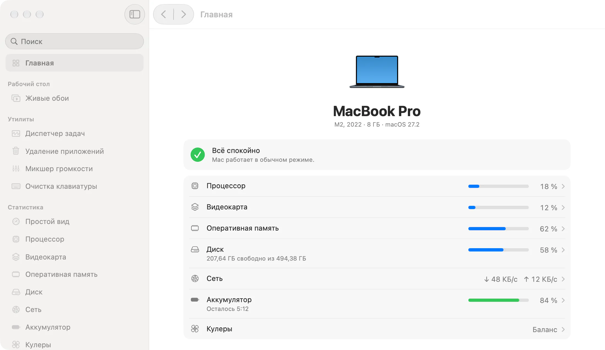
</picture>

## Почему Tweakly

- **Выглядит как часть macOS.** Только системные компоненты, материалы, шрифты и цвета: Liquid Glass там, где он есть в macOS, страницы как в Системных настройках.
- **Выключенное ничего не стоит.** Каждая функция включается отдельно, а выключенная не держит ни таймеров, ни наблюдателей, ни памяти. Агент со всем выключенным занимает около 8 МБ и не тратит процессор.
- **Одно приложение вместо десятка.** Без подписок, аккаунтов и телеметрии.

## Возможности

### Окна

**Переключатель окон.** Command-Tab с плиткой и живым превью каждого окна, в том числе свёрнутых и открытых на других рабочих столах. Отпустите Command, чтобы перейти.

<picture>
  <source media="(prefers-color-scheme: dark)" srcset=".github/images/switcher-ru-dark.webp">
  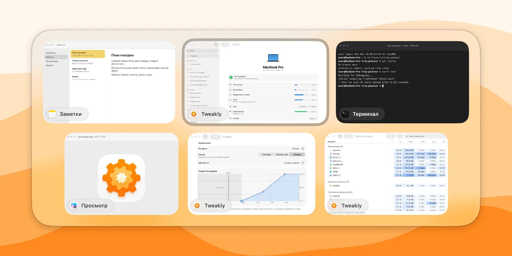
</picture>

**Превью в Dock.** Задержите указатель на приложении в Dock, и над ним появятся его окна. Клик по приложению на переднем плане сворачивает его, как в Windows.

<picture>
  <source media="(prefers-color-scheme: dark)" srcset=".github/images/dock-ru-dark.webp">
  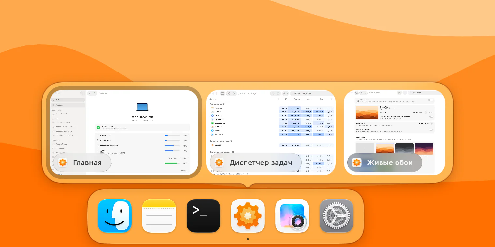
</picture>

### Строка меню

**Статистика.** Процессор, графика, память, диск, сеть и аккумулятор, у каждого свой значок, стиль и частота обновления. Клик открывает панель с графиком и приложениями, которые нагружают Mac.

**Простой вид.** Один значок вместо шести и панель с кольцами или списком. Значком может быть шестерёнка, кот или ваша картинка, а ещё он может заполняться по нагрузке.

<table>
  <tr>
    <td width="50%">
      <picture>
        <source media="(prefers-color-scheme: dark)" srcset=".github/images/stats-ru-dark.webp">
        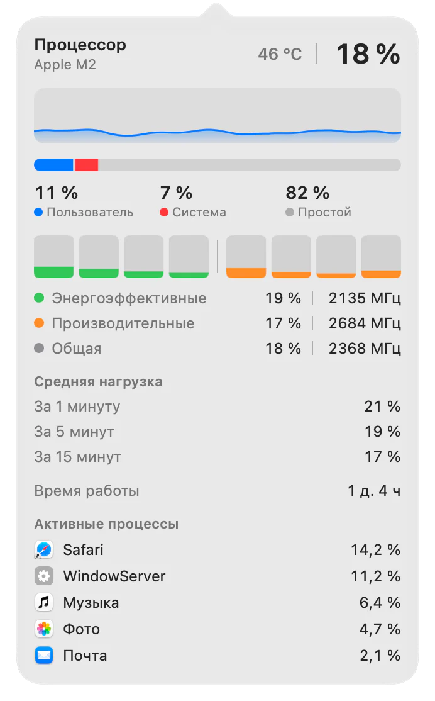
      </picture>
    </td>
    <td width="50%">
      <picture>
        <source media="(prefers-color-scheme: dark)" srcset=".github/images/simple-view-ru-dark.webp">
        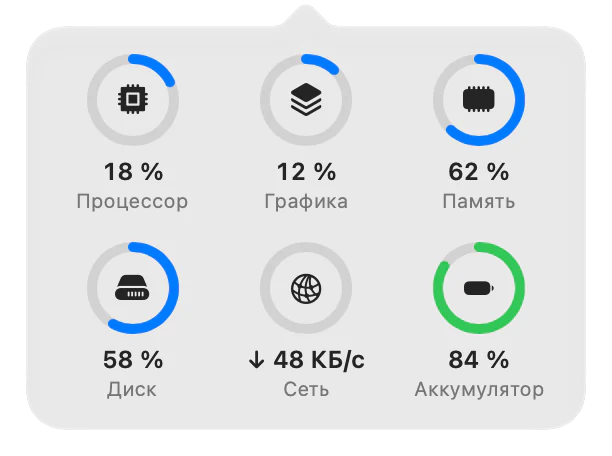
      </picture>
      <br><br>
      <picture>
        <source media="(prefers-color-scheme: dark)" srcset=".github/images/mixer-ru-dark.webp">
        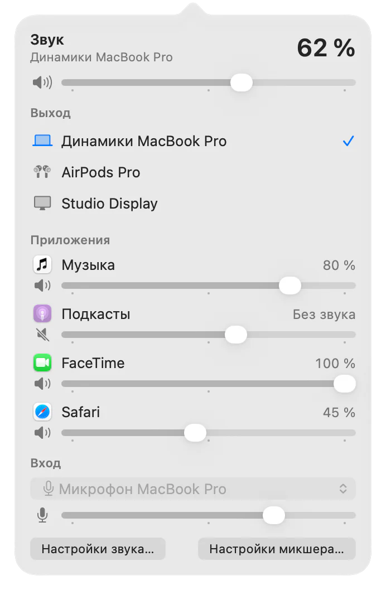
      </picture>
    </td>
  </tr>
</table>

**Микшер громкости.** Общая громкость и выход, а для каждого играющего приложения своя громкость от 0 до 200 % и свой выход.

**Кулеры.** Пять профилей, постоянная скорость или своя кривая по выбранному датчику, для каждого кулера и отдельно от аккумулятора. На Mac с кулерами.

### Утилиты

**Диспетчер задач.** Все процессы в одной таблице с процессором, памятью, диском, сетью и графикой, по группам: приложения, фоновые и системные процессы. Открывается по Control-Shift-Escape.

<picture>
  <source media="(prefers-color-scheme: dark)" srcset=".github/images/task-manager-ru-dark.webp">
  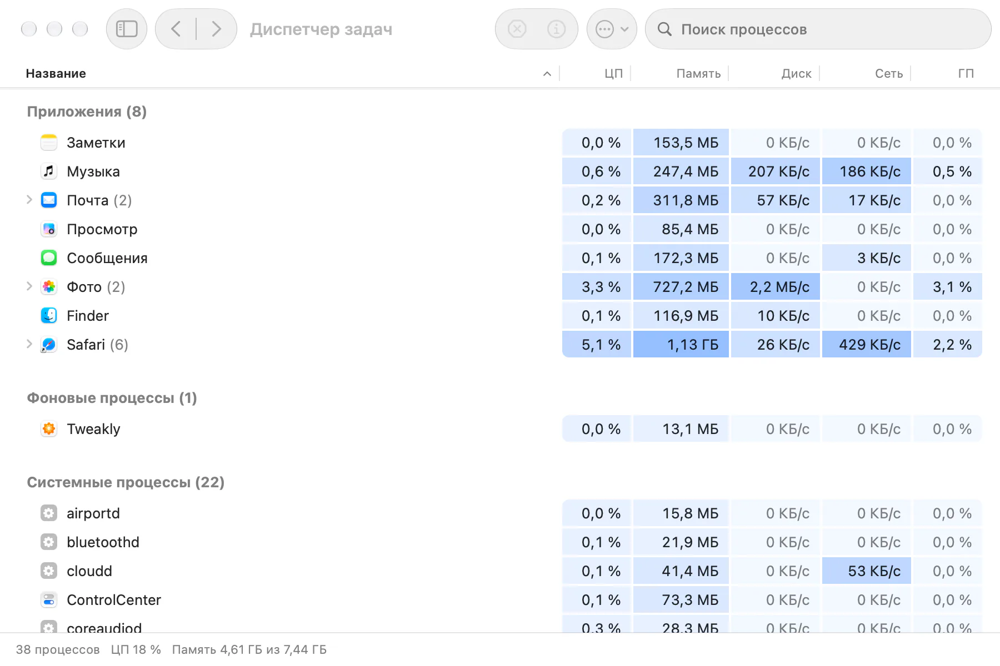
</picture>

**Удаление приложений.** Удаляет приложение вместе с настройками, кэшами, данными, контейнерами и фоновыми службами. Всё уходит в Корзину, так что любое можно вернуть.

<picture>
  <source media="(prefers-color-scheme: dark)" srcset=".github/images/uninstaller-ru-dark.webp">
  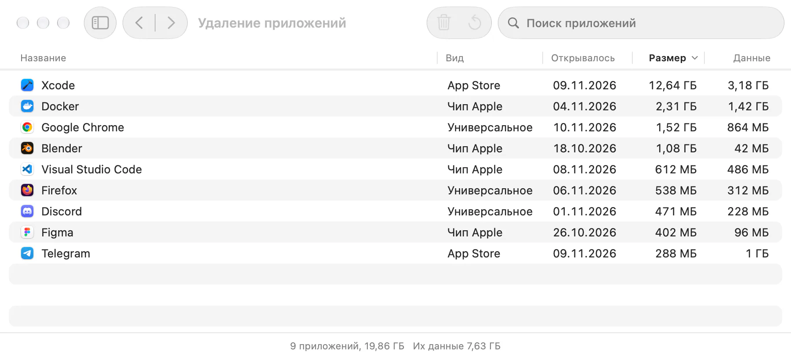
</picture>

**Очистка клавиатуры.** Отключает клавиатуру на время, чтобы её можно было протереть. Трекпад и мышь продолжают работать.

### Рабочий стол

**Живые обои.** Видео и картинки на рабочем столе, своя библиотека и браузер сайтов с обоями. Видео играет, только пока его кто-то видит, и по желанию встаёт на паузу от аккумулятора.

<picture>
  <source media="(prefers-color-scheme: dark)" srcset=".github/images/live-wallpaper-ru-dark.webp">
  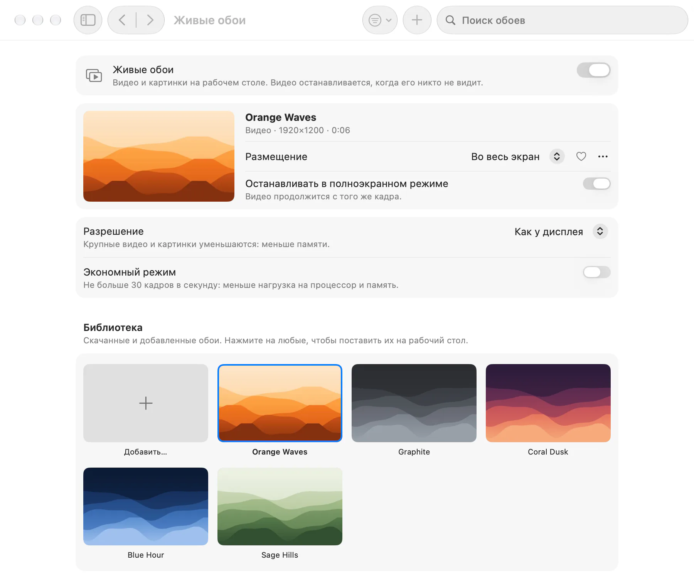
</picture>

### Ввод и Finder

**Мышь.** Указатель без ускорения на своей скорости, колесо отдельно от трекпада, плавная прокрутка, «Назад» и «Вперёд» на боковых кнопках.

**Смена языка.** Короткое нажатие Fn включает предыдущий источник ввода, без меню.

**Вырезание в Finder.** Command-X вырезает файлы, Command-V перемещает их. Переносит сам Finder.

**Меню Finder.** «Новый файл», «Скопировать путь» и «Открыть в Терминале» по правому клику.

<table>
  <tr>
    <td width="50%">
      <picture>
        <source media="(prefers-color-scheme: dark)" srcset=".github/images/mouse-ru-dark.webp">
        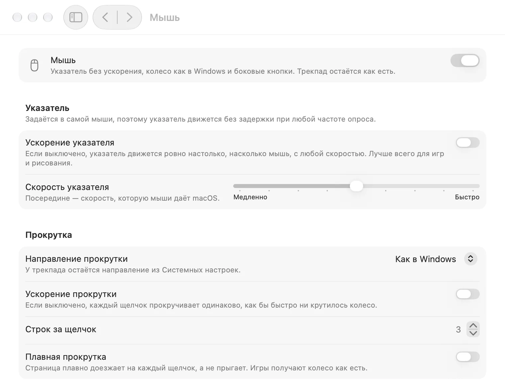
      </picture>
    </td>
    <td width="50%">
      <picture>
        <source media="(prefers-color-scheme: dark)" srcset=".github/images/fans-ru-dark.webp">
        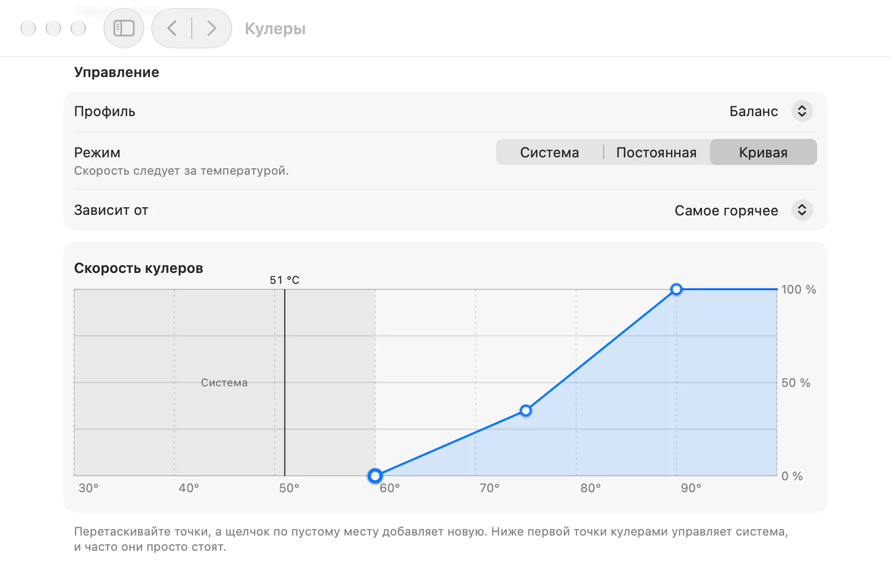
      </picture>
    </td>
  </tr>
</table>

## Установка

1. Скачайте [Tweakly.dmg](../../releases/latest/download/Tweakly.dmg), это последний релиз.
2. Откройте образ и перетащите Tweakly в «Программы».
3. Откройте Tweakly. macOS один раз спросит, открыть ли приложение, загруженное из интернета.

Tweakly подписан Developer ID и нотаризован Apple. Нужна **macOS 26 или новее на Mac с Apple silicon**.

Обновления сохраняют настройки и разрешения: просто поставьте новую версию поверх старой.

## Разрешения

Tweakly просит разрешение, только когда вы включаете функцию, которой оно нужно, и никогда при запуске. Все разрешения собраны на одной странице, **Разрешения**, как в «Конфиденциальности и безопасности»: для чего каждое, какие функции им пользуются, выдано ли оно, и кнопка, которая его выдаёт. Если разрешение отозвать, зависящие от него функции выключатся сами и скажут почему.

| Разрешение | Для чего |
|---|---|
| Универсальный доступ | Переключатель окон, Превью в Dock, Мышь (колесо и кнопки), Вырезание в Finder, Смена языка, Очистка клавиатуры |
| Запись экрана и системного звука | Превью окон в переключателе и Dock. Без неё на плитках значки приложений |
| Только запись системного звука | Своя громкость у каждого приложения в микшере |
| Доступ к диску | Удаление приложений, для данных приложений из App Store. Необязательно |
| Файлы и папки | «Новый файл» в меню Finder на рабочем столе, в «Документах» и «Загрузках» |
| Пароль администратора, один раз | Помощник для кулеров и для процессов других пользователей в диспетчере задач |

## Приватность

В Tweakly нет аналитики, аккаунтов и сервера обновлений. В сеть он выходит только в двух случаях:

- Пока открыта панель сети, он спрашивает у Cloudflare (`1.1.1.1`) ваш внешний адрес и меряет до него задержку.
- Браузер обоев открывает сайты, на которые вы в нём заходите.

Картинки и видео извне сначала проверяет и записывает заново помощник в песочнице без доступа к сети, и только потом их читает всё остальное.

## Вопросы и ответы

**Значков Tweakly нет в строке меню.**
На Mac с вырезом то, что не помещается, уходит под вырез, а macOS умеет скрывать значки приложений: проверьте, что Tweakly разрешён в Системных настройках › Строка меню. На тесной строке меню помогают меньшее число значков или Простой вид, которому нужен один значок.

**В Системных настройках разрешение включено, а Tweakly пишет, что его нет.**
macOS привязывает разрешения к подписи приложения, поэтому переключатель, оставшийся от другой сборки, больше не действует. Выключите и снова включите Tweakly в Системных настройках или сбросьте разрешение в Терминале и выдайте его заново на странице «Разрешения»:

```bash
tccutil reset Accessibility me.tweakly.Tweakly
```

**Вместо снимков окон значки приложений.**
Для снимков нужна «Запись экрана и системного звука». Разрешите её на странице «Разрешения»; снимки появятся после перезапуска Tweakly, он сам это предложит. Каждый раз, когда делается снимок, macOS на несколько секунд зажигает индикатор записи.

**Нет страницы «Кулеры».**
Она есть только на Mac с кулерами. У MacBook Air их нет.

**Почему только macOS 26 и Apple silicon?**
Tweakly собран из компонентов самой macOS 26, в том числе Liquid Glass, и читает датчики и устройство ядер Apple silicon.

## Удаление

1. Если пользуетесь живыми обоями, сначала выключите их: Tweakly вернёт вашу картинку рабочего стола.
2. Если ставили помощника для кулеров или диспетчера задач, удалите его: «Кулеры» › «Дополнительно…» › «Удалить…».
3. Завершите Tweakly («О приложении» › «Завершить Tweakly») и перенесите его из «Программ» в Корзину.

Чтобы удалить и настройки с данными:

```bash
defaults delete me.tweakly.Tweakly
rm -rf ~/Library/Application\ Support/me.tweakly.Tweakly ~/Library/Caches/me.tweakly.Tweakly
tccutil reset All me.tweakly.Tweakly
```

На Mac без кулеров, где нет страницы «Кулеры», помощник удаляется так:

```bash
sudo launchctl bootout system/me.tweakly.Tweakly.fanhelper
sudo rm /Library/LaunchDaemons/me.tweakly.Tweakly.fanhelper.plist /Library/PrivilegedHelperTools/me.tweakly.Tweakly.fanhelper
```

## Языки

Английский, русский, немецкий, японский и упрощённый китайский. У окна, строки меню и панелей может быть свой язык.

## Сборка из исходников

Нужен Xcode 27 с macOS 26 SDK.

```bash
xcodebuild -project Tweakly.xcodeproj -scheme Tweakly -configuration Release -derivedDataPath build build
```

Логика каждой функции лежит в своём пакете Swift в `Packages/`, со своими тестами:

```bash
swift test --package-path Packages/SystemMetrics
```

У сборки с вашей подписью будут свои разрешения: macOS привязывает их к подписи, поэтому сборку с другой подписью придётся разрешить заново.

## Участие

Сообщения об ошибках, идеи и переводы приветствуются. Сначала прочитайте [CONTRIBUTING.md](CONTRIBUTING.md), а об уязвимостях сообщайте приватно, как написано в [SECURITY.md](SECURITY.md).

## Лицензия

[MIT](LICENSE)
