<p align="center">
  
</p>

<h1 align="center">Tweakly</h1>

<p align="center">
  <b>macOS缺少的那些小功能，集于一个原生App。</b><br>
  菜单栏里的Mac负载、带窗口预览的Command-Tab、任务管理器、动态墙纸等等。
</p>

<p align="center">
  <a href="../../releases/latest"></a>
  
  
  
  <a href="LICENSE"></a>
</p>

<p align="center">
  <a href="README.md">English</a> · <a href="README.ru.md">Русский</a> · <a href="README.de.md">Deutsch</a> · <a href="README.ja.md">日本語</a> · <b>简体中文</b>
</p>

<p align="center">
  <a href="../../releases/latest/download/Tweakly.dmg"><b>下载</b></a> · <a href="https://tweakly.me">网站</a>
</p>

<picture>
  <source media="(prefers-color-scheme: dark)" srcset=".github/images/home-en-dark.webp">
  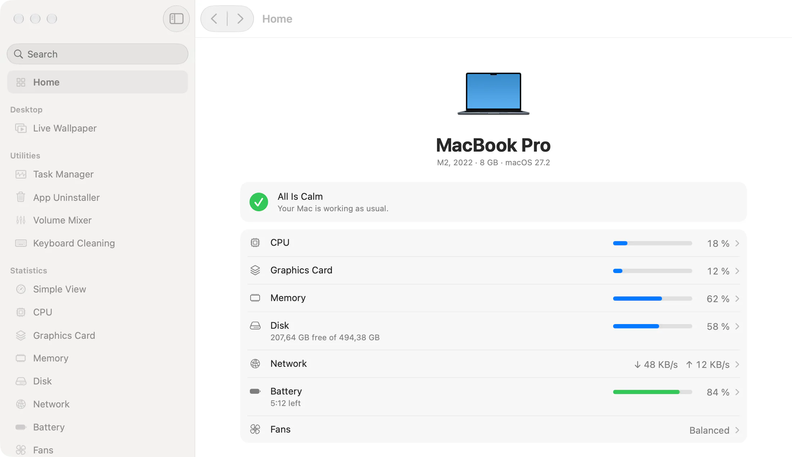
</picture>

## 为什么选择Tweakly

- **看起来就是macOS的一部分。** 只使用系统的组件、材质、字体和颜色：macOS有Liquid Glass的地方就用Liquid Glass，窗口中的页面与“系统设置”一致。
- **关闭的功能不占任何资源。** 每个功能单独打开，关闭的功能没有计时器、没有观察器，也不占内存。全部关闭时，代理进程约占8 MB内存，不占用CPU。
- **一个App顶十个。** 没有订阅，没有账户，没有遥测。

## 功能

### 窗口

**窗口切换器。** 带有每个窗口的缩略图和实时预览的Command-Tab，最小化的窗口和其他桌面上的窗口也包括在内。松开Command键即可切换。

<picture>
  <source media="(prefers-color-scheme: dark)" srcset=".github/images/switcher-en-dark.webp">
  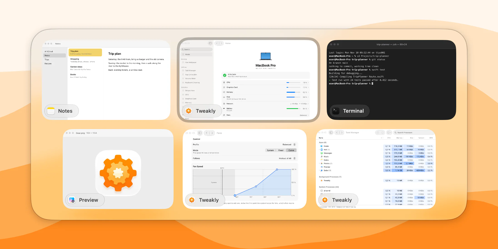
</picture>

**程序坞预览。** 将指针停在程序坞中的App上，它的窗口就会显示在上方。点按前台App的图标会将其最小化，就像在Windows中一样。

<picture>
  <source media="(prefers-color-scheme: dark)" srcset=".github/images/dock-en-dark.webp">
  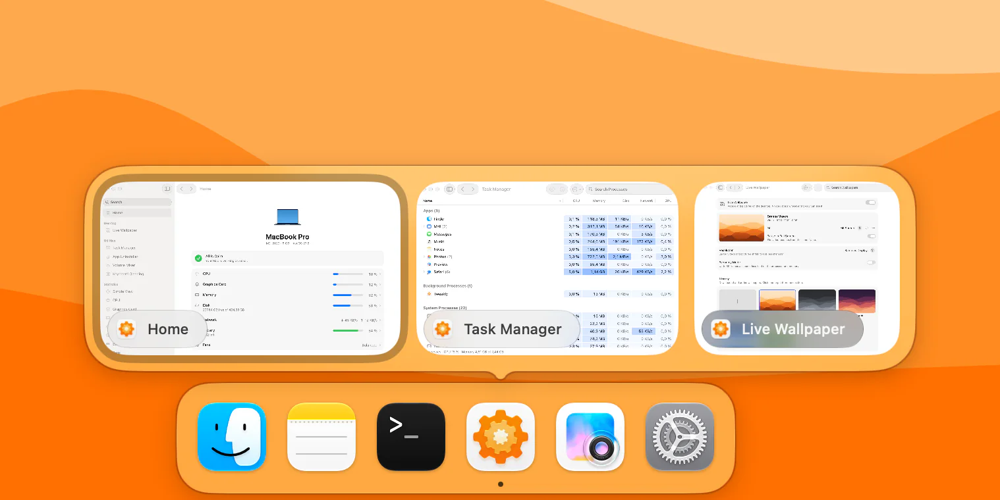
</picture>

### 菜单栏

**统计。** CPU、图形、内存、磁盘、网络和电池，每项都有自己的图标、样式和更新频率。点按即可打开一个面板，显示图表以及让你的Mac忙碌的App。

**简洁视图。** 用一个图标代替六个，面板中以圆环或列表显示。图标可以是齿轮、小猫或你自己的图片，还能随负载填充。

<table>
  <tr>
    <td width="50%">
      <picture>
        <source media="(prefers-color-scheme: dark)" srcset=".github/images/stats-en-dark.webp">
        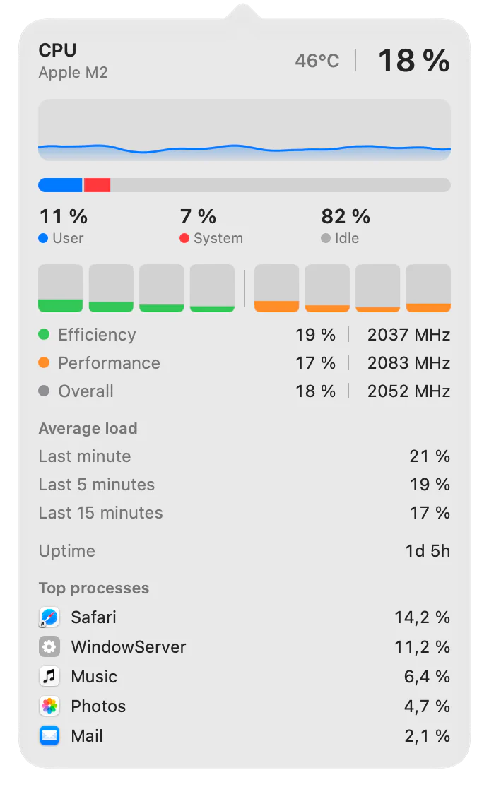
      </picture>
    </td>
    <td width="50%">
      <picture>
        <source media="(prefers-color-scheme: dark)" srcset=".github/images/simple-view-en-dark.webp">
        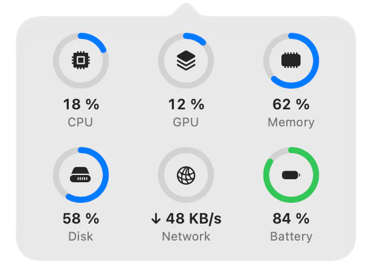
      </picture>
      <br><br>
      <picture>
        <source media="(prefers-color-scheme: dark)" srcset=".github/images/mixer-en-dark.webp">
        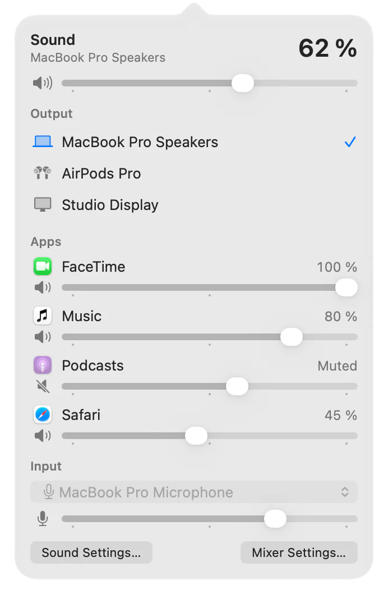
      </picture>
    </td>
  </tr>
</table>

**音量合成器。** 总音量和输出设备，此外每个正在播放的App都有自己的音量（0至200%）和输出设备。

**风扇。** 五种配置文件、固定转速，或按你选择的传感器设定的自定曲线，可按风扇分别设置，也可单独设置使用电池时的方案。适用于配备风扇的Mac。

### 实用工具

**任务管理器。** 在一个表格中显示所有进程的CPU、内存、磁盘、网络和GPU，并分为App、后台进程和系统进程。按Control-Shift-Escape打开。

<picture>
  <source media="(prefers-color-scheme: dark)" srcset=".github/images/task-manager-en-dark.webp">
  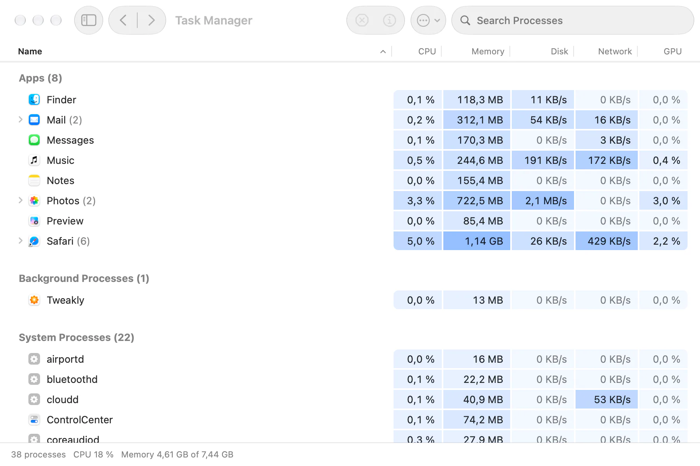
</picture>

**App卸载。** 移除App及其设置、缓存、数据、容器和后台服务，全部移到废纸篓，随时可以放回原处。

<picture>
  <source media="(prefers-color-scheme: dark)" srcset=".github/images/uninstaller-en-dark.webp">
  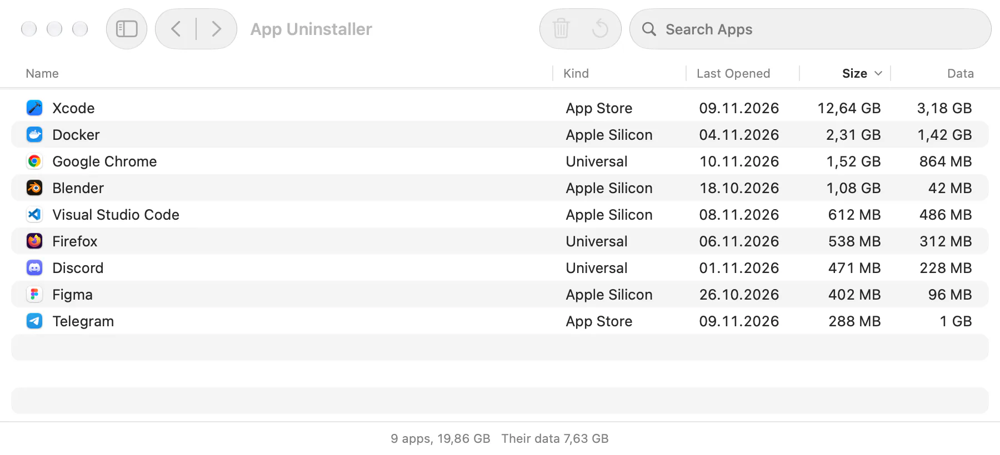
</picture>

**键盘清洁。** 暂时关闭键盘，方便你擦拭。触控板和鼠标照常工作。

### 桌面

**动态墙纸。** 桌面上的视频和图片，自己的资料库，以及墙纸网站浏览器。视频只在有人看得见时播放，如需要，使用电池时会暂停。

<picture>
  <source media="(prefers-color-scheme: dark)" srcset=".github/images/live-wallpaper-en-dark.webp">
  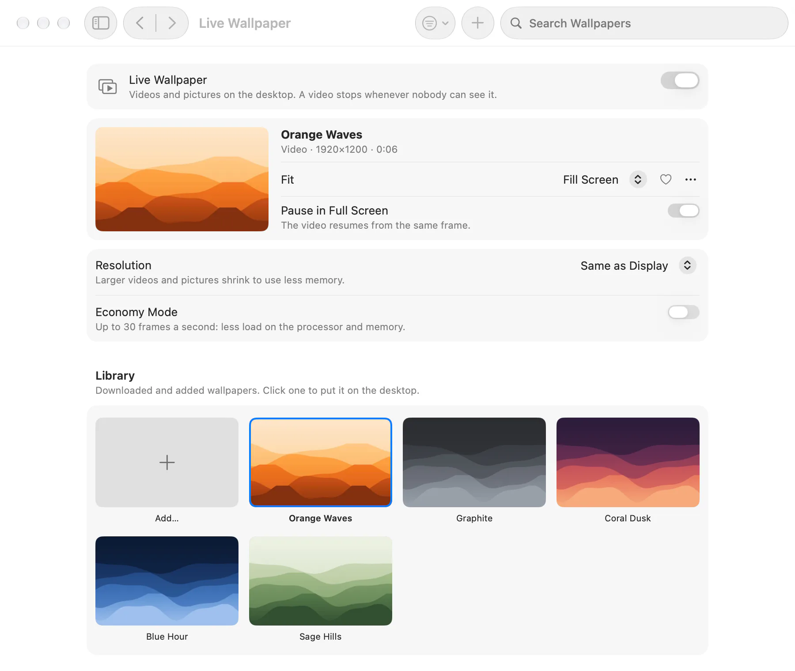
</picture>

### 输入与访达

**鼠标。** 无加速的指针和自定速度，与触控板分开的滚轮，平滑滚动，以及侧边按钮上的后退和前进。

**语言切换。** 短按Fn即可切换到上一个输入法，无需打开菜单。

**在访达中剪切。** 用Command-X剪切文件，用Command-V移动文件。移动由访达自己完成。

**访达菜单。** 右键点按即可“新建文件”、“拷贝路径”和“在终端中打开”。

<table>
  <tr>
    <td width="50%">
      <picture>
        <source media="(prefers-color-scheme: dark)" srcset=".github/images/mouse-en-dark.webp">
        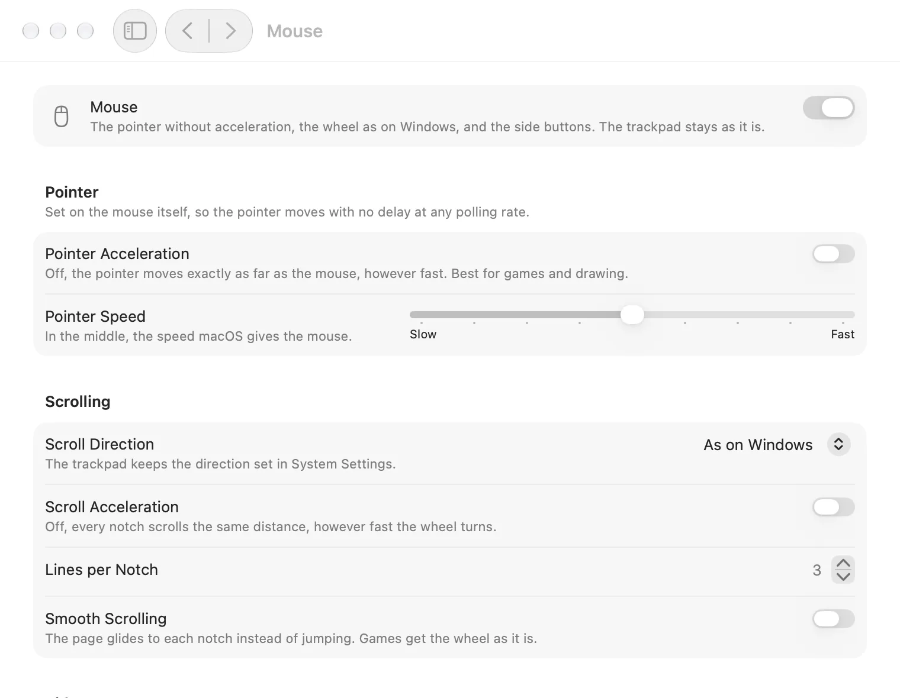
      </picture>
    </td>
    <td width="50%">
      <picture>
        <source media="(prefers-color-scheme: dark)" srcset=".github/images/fans-en-dark.webp">
        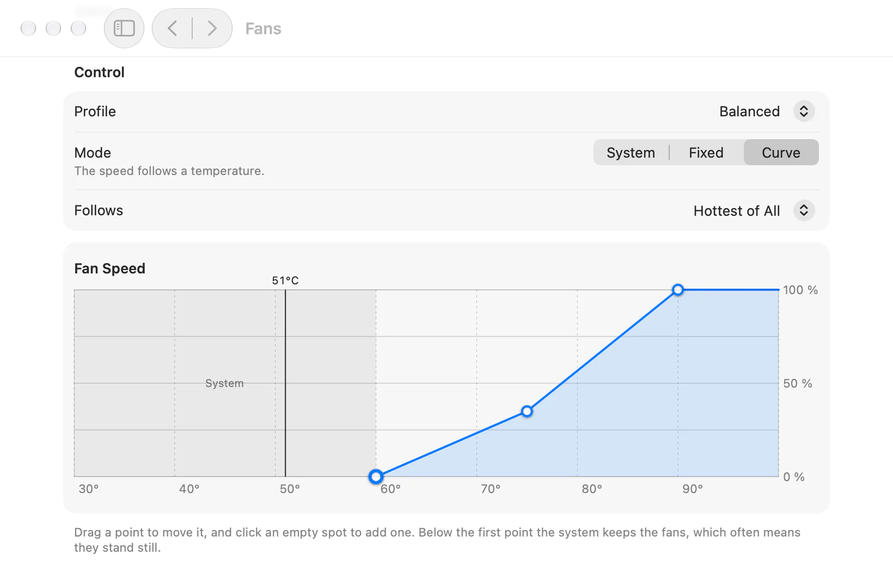
      </picture>
    </td>
  </tr>
</table>

## 安装

1. 下载最新版本的[Tweakly.dmg](../../releases/latest/download/Tweakly.dmg)。
2. 打开磁盘映像，将Tweakly拖到“应用程序”。
3. 打开Tweakly。macOS会询问一次是否打开从互联网下载的App。

Tweakly已使用Developer ID签名，并经过Apple公证。需要**配备Apple芯片的Mac，macOS 26或更高版本**。

更新会保留你的设置和权限：只需将新版本安装在旧版本之上。

## 权限

只有在你打开需要某项权限的功能时，Tweakly才会请求该权限，启动时从不请求。所有权限都集中在一个页面——**权限**，就像“隐私与安全”一样：每项权限的用途、哪些功能使用它、是否已允许，以及允许它的按钮。如果你撤销某项权限，需要它的功能会自动关闭并说明原因。

| 权限 | 用途 |
|---|---|
| 无障碍 | 窗口切换器、程序坞预览、鼠标（滚轮和按钮）、在访达中剪切、语言切换、键盘清洁 |
| 录屏与系统录音 | 窗口切换器和程序坞预览中的窗口预览。没有此权限时，缩略图显示App图标 |
| 仅系统录音 | 音量合成器中每个App的音量 |
| 完全磁盘访问权限 | App卸载，用于查找来自App Store的App的数据。可选 |
| 文件与文件夹 | 在桌面、“文稿”和“下载”中使用访达菜单的“新建文件” |
| 管理员密码（一次） | 用于风扇以及任务管理器中其他用户进程的辅助程序 |

## 隐私

Tweakly没有分析，没有账户，也没有更新服务器。它只在两种情况下联网：

- 网络面板打开时，它会向Cloudflare（`1.1.1.1`）查询你的公网地址，并测量到那里的延迟。
- 墙纸浏览器会打开你在其中访问的网站。

来自外部的图片和视频，会先由一个无法访问网络的沙盒辅助程序检查并重新写入，然后其他部分才会读取。

## 常见问题

**菜单栏中没有Tweakly的图标。**
在带刘海的Mac上，放不下的项目会藏到刘海后面，而且macOS可以隐藏App的项目：请检查“系统设置”›“菜单栏”中是否允许了Tweakly。菜单栏太满时，减少项目，或使用只需一个图标的简洁视图。

**“系统设置”中已打开权限，但Tweakly提示未允许。**
macOS将权限与App的签名绑定，因此其他构建版本留下的开关不再有效。请在“系统设置”中将Tweakly的开关关闭后再打开，或在终端中重置该权限，然后在“权限”页面重新允许：

```bash
tccutil reset Accessibility me.tweakly.Tweakly
```

**窗口预览显示的是App图标而不是画面。**
预览需要“录屏与系统录音”权限。在“权限”页面允许后，Tweakly重新启动时就会显示画面（App会提示你重新启动）。每次截取画面时，macOS都会显示录制指示器几秒钟。

**没有“风扇”页面。**
它只在配备风扇的Mac上出现。MacBook Air没有风扇。

**为什么只支持macOS 26和Apple芯片？**
Tweakly由macOS 26自身的组件构建（包括Liquid Glass），并读取Apple芯片的传感器和核心布局。

## 卸载

1. 如果你在使用动态墙纸，请先将其关闭：Tweakly会恢复你的桌面图片。
2. 如果你为风扇或任务管理器安装了辅助程序，请将其移除：“风扇”›“高级…”›“移除…”。
3. 退出Tweakly（“关于”›“退出Tweakly”），然后将其从“应用程序”移到废纸篓。

如需同时移除设置和数据：

```bash
defaults delete me.tweakly.Tweakly
rm -rf ~/Library/Application\ Support/me.tweakly.Tweakly ~/Library/Caches/me.tweakly.Tweakly
tccutil reset All me.tweakly.Tweakly
```

在没有风扇（因而没有“风扇”页面）的Mac上，用以下命令移除辅助程序：

```bash
sudo launchctl bootout system/me.tweakly.Tweakly.fanhelper
sudo rm /Library/LaunchDaemons/me.tweakly.Tweakly.fanhelper.plist /Library/PrivilegedHelperTools/me.tweakly.Tweakly.fanhelper
```

## 语言

英语、俄语、德语、日语和简体中文。窗口、菜单栏和面板可以分别使用不同的语言。

## 从源代码构建

需要带有macOS 26 SDK的Xcode 27。

```bash
xcodebuild -project Tweakly.xcodeproj -scheme Tweakly -configuration Release -derivedDataPath build build
```

每个功能的逻辑都在`Packages/`下各自的Swift包中，并带有自己的测试：

```bash
swift test --package-path Packages/SystemMetrics
```

由你自己签名的构建会有自己的权限：macOS将权限与签名绑定，签名不同的构建需要重新允许。

## 参与贡献

欢迎报告错误、提出想法和帮助翻译。请先阅读[CONTRIBUTING.md](CONTRIBUTING.md)，并按照[SECURITY.md](SECURITY.md)中的说明私下报告安全问题。

## 许可证

[MIT](LICENSE)
